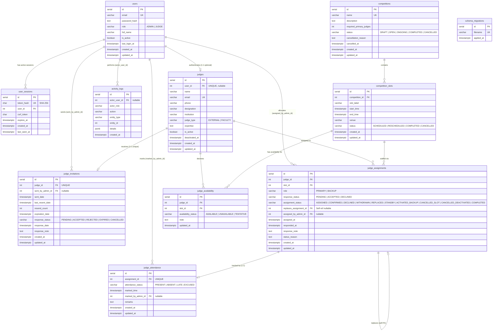

# JuryPanel — Database Schema & Architecture Guide

**PostgreSQL Schema Reference for the BAUST CSE Fest Judge Invitation & Allocation Management System**

---

## Table of Contents

1. [Overview & Design Principles](#1-overview--design-principles)
2. [Entity-Relationship Diagrams](#2-entity-relationship-diagrams)
   - [Mermaid ER Diagram](#21-mermaid-er-diagram)
   - [Visual Connectivity & Flow Map (ASCII)](#22-visual-connectivity--flow-map-ascii)
3. [Relationship & Cardinality Summary](#3-relationship--cardinality-summary)
4. [Detailed Table-by-Table Reference](#4-detailed-table-by-table-reference)
   - [4.1 `users`](#41-users)
   - [4.2 `user_sessions`](#42-user_sessions)
   - [4.3 `judges`](#43-judges)
   - [4.4 `judge_invitations`](#44-judge_invitations)
   - [4.5 `competitions`](#45-competitions)
   - [4.6 `competition_slots`](#46-competition_slots)
   - [4.7 `judge_availability`](#47-judge_availability)
   - [4.8 `judge_assignments`](#48-judge_assignments)
   - [4.9 `judge_attendance`](#49-judge_attendance)
   - [4.10 `activity_logs`](#410-activity_logs)
   - [4.11 `schema_migrations`](#411-schema_migrations)
5. [Database Triggers & Integrity Rules (`P0001`–`P0006`)](#5-database-triggers--integrity-rules-p0001p0006)
6. [How Tables Work Together Across Key Workflows](#6-how-tables-work-together-across-key-workflows)

---

## 1. Overview & Design Principles

JuryPanel uses **PostgreSQL** (hosted on Supabase or standard PostgreSQL) accessed via the Node.js `pg` connection pool (`server/db.ts`). The schema is defined in `db/migrations/001_initial_schema.sql` and applied transactionally via `db/migrate.ts`.

### Key Architectural Decisions

1. **Identity vs. Domain Separation (`users` vs. `judges`)**
   - `users` handles authentication, passwords (`bcrypt` hashes), roles (`ADMIN` / `JUDGE`), and active login sessions (`user_sessions`).
   - `judges` stores domain attributes (designation, institution, phone, expertise, `EXTERNAL` vs. `FACULTY`) and links to `users(id)` via a nullable `UNIQUE` foreign key.

2. **Audit-Safe History (`ON DELETE RESTRICT` & Soft State Transitions)**
   - Core operational tables (`competition_slots`, `judge_invitations`, `judge_availability`, `judge_assignments`, `judge_attendance`) use `ON DELETE RESTRICT` rather than cascading deletes.
   - Instead of deleting records when a judge is deactivated, an assignment is withdrawn, a judge is replaced, or a competition/slot is cancelled, rows transition to explicit terminal statuses (`WITHDRAWN`, `DECLINED`, `REPLACED`, `CANCELLED_SLOT`, `CANCELLED_DEACTIVATED`).
   - Only `user_sessions` uses `ON DELETE CASCADE` (sessions have no standalone business meaning if a user row is removed). Audit-actor references (`sent_by_admin_id`, `assigned_by_admin_id`, `marked_by_admin_id`, `actor_user_id`) use `ON DELETE SET NULL`.

3. **Defense-in-Depth Concurrency & Integrity**
   - Application routes wrap multi-step updates in `BEGIN ... COMMIT` transactions with row-level locks (`SELECT ... FOR UPDATE`).
   - PostgreSQL enforces invariants directly at the database level via **`CHECK` constraints**, **partial unique indexes**, and **`BEFORE INSERT/UPDATE` PL/pgSQL triggers**.

---

## 2. Entity-Relationship Diagrams

### 2.1 Mermaid ER Diagram



---

### 2.2 Visual Connectivity & Flow Map (ASCII)

```text
+-------------------+       1:N (CASCADE)       +--------------------+
|       users       | ------------------------> |   user_sessions    |
| (ADMIN / JUDGE)   |                           | (auth + CSRF hash) |
+-------------------+                           +--------------------+
   |   |   |   |  \
   |   |   |   |   \ 1:N (SET NULL)
   |   |   |   |    +-------------------------------------------------+
   |   |   |   |                                                      v
   |   |   |   +---(SET NULL: sent/assigned/marked_by)---+    +---------------+
   |   |   |                                             |    | activity_logs |
   |   |   | 1:1 Optional (SET NULL)                     |    | (JSONB audit) |
   |   v   v                                             |    +---------------+
+-------------------+       1:1 (UNIQUE, RESTRICT)       v
|      judges       | ----------------------------> +-------------------+
| EXTERNAL/FACULTY  |                               | judge_invitations |
+-------------------+                               +-------------------+
   |            |
   |            +------------------- 1:N (RESTRICT) -------------------+
   |                                                                   |
   | 1:N (RESTRICT)                                                    v
   v                                                          +--------------------+
+--------------------+      N:1 (RESTRICT)       +----------> | judge_assignments  | <-+
| judge_availability | <---+                     |            | PRIMARY / BACKUP   |   |
+--------------------+     |                     |            +--------------------+   |
                           |                     |               |        |            |
+--------------------+     |                     |               |        +-- self-FK -+
|    competitions    |     |                     |               |  (replaces_assignment_id)
+--------------------+     |                     |               |
   |                       |                     |               | 1:1 (UNIQUE, RESTRICT)
   | 1:N (RESTRICT)        |                     |               v
   v                       |                     |            +--------------------+
+--------------------+ ----+---------------------+            |  judge_attendance  |
| competition_slots  |                                        | PRESENT/ABSENT/... |
+--------------------+                                        +--------------------+

[Standalone System Table]: schema_migrations (tracks applied SQL migration files)
```

---

## 3. Relationship & Cardinality Summary

| Relationship | Cardinality | Foreign Key & Rule | Purpose |
| :--- | :---: | :--- | :--- |
| `users` → `user_sessions` | **1 : N** | `user_sessions.user_id` (`ON DELETE CASCADE`) | Allows multiple active browser/device sessions per user. |
| `users` → `judges` | **1 : 0..1** | `judges.user_id` (`UNIQUE`, `ON DELETE SET NULL`) | Links a judge profile to its portal login account (`role = 'JUDGE'`). |
| `judges` → `judge_invitations` | **1 : 0..1** | `judge_invitations.judge_id` (`UNIQUE`, `ON DELETE RESTRICT`) | Enforces one fest invitation record per judge (reopened in place on resend). |
| `users` → `judge_invitations` | **1 : N** | `judge_invitations.sent_by_admin_id` (`ON DELETE SET NULL`) | Records which admin sent or last resent the invitation. |
| `competitions` → `competition_slots` | **1 : N** | `competition_slots.competition_id` (`ON DELETE RESTRICT`) | Breaks each competition into one or more scheduled time windows/venues. |
| `judges` ↔ `competition_slots` (via `judge_availability`) | **M : N** | `judge_id` & `slot_id` (`UNIQUE (judge_id, slot_id)`, `ON DELETE RESTRICT`) | Stores each judge's declared availability per competition slot. |
| `judges` ↔ `competition_slots` (via `judge_assignments`) | **M : N** | `judge_id` & `slot_id` (`ON DELETE RESTRICT`) | Allocates judges to slots as `PRIMARY` or `BACKUP` (with history preserved). |
| `judge_assignments` → `judge_assignments` | **1 : 0..1** *(chain)* | `replaces_assignment_id` (`ON DELETE RESTRICT`) | Links an activated backup assignment directly to the replaced assignment it covers. |
| `judge_assignments` → `judge_attendance` | **1 : 0..1** | `judge_attendance.assignment_id` (`UNIQUE`, `ON DELETE RESTRICT`) | Stores one competition-day attendance record per assignment. |
| `users` → `judge_assignments` / `judge_attendance` / `activity_logs` | **1 : N** | `assigned_by_admin_id`, `marked_by_admin_id`, `actor_user_id` (`ON DELETE SET NULL`) | Tracks which user performed each assignment, attendance mark, or audited action. |

---

## 4. Detailed Table-by-Table Reference

### 4.1 `users`

**Purpose:** Central authentication and authorization account store for both **Fest Administrators** (`ADMIN`) and **Judges** (`JUDGE`). Never stores plaintext passwords.

| Column | Type | Constraints / Default | Description |
| :--- | :--- | :--- | :--- |
| `id` | `SERIAL` | `PRIMARY KEY` | Internal user ID. |
| `email` | `VARCHAR(255)` | `NOT NULL`, `UNIQUE` | Login email (checked case-insensitively in queries). |
| `password_hash` | `TEXT` | `NOT NULL` | `bcrypt` hash (cost factor 12). |
| `role` | `VARCHAR(20)` | `NOT NULL`, `CHECK (role IN ('ADMIN', 'JUDGE'))` | Determines portal access (`Admin Portal` vs. `Judge Portal`). |
| `full_name` | `VARCHAR(255)` | `NOT NULL` | Display name shown in sidebar and audit actor logs. |
| `is_active` | `BOOLEAN` | `NOT NULL`, `DEFAULT TRUE` | Disables authentication when `FALSE`. |
| `last_login_at` | `TIMESTAMPTZ` | Nullable | Timestamp of most recent successful sign-in. |
| `created_at` | `TIMESTAMPTZ` | `NOT NULL`, `DEFAULT NOW()` | Creation timestamp. |
| `updated_at` | `TIMESTAMPTZ` | `NOT NULL`, `DEFAULT NOW()` | Last update timestamp. |

**How it connects:**
- Referenced by `user_sessions`, `judges.user_id`, `judge_invitations.sent_by_admin_id`, `judge_assignments.assigned_by_admin_id`, `judge_attendance.marked_by_admin_id`, and `activity_logs.actor_user_id`.

---

### 4.2 `user_sessions`

**Purpose:** Server-side HTTP session and CSRF token store. Enables instant session revocation (on logout, password reset, or judge deactivation).

| Column | Type | Constraints / Default | Description |
| :--- | :--- | :--- | :--- |
| `id` | `SERIAL` | `PRIMARY KEY` | Session record ID. |
| `token_hash` | `CHAR(64)` | `NOT NULL`, `UNIQUE` | SHA-256 hex digest of the cookie session token (raw token is never stored). |
| `user_id` | `INTEGER` | `NOT NULL`, `REFERENCES users(id) ON DELETE CASCADE` | Owning user account. |
| `csrf_token` | `CHAR(64)` | `NOT NULL` | Per-session CSRF token validated on state-changing requests via `X-CSRF-Token`. |
| `expires_at` | `TIMESTAMPTZ` | `NOT NULL` | Session expiration timestamp. |
| `created_at` | `TIMESTAMPTZ` | `NOT NULL`, `DEFAULT NOW()` | Session start time. |
| `last_seen_at` | `TIMESTAMPTZ` | `NOT NULL`, `DEFAULT NOW()` | Updated on authenticated activity. |

**Indexes:**
- `idx_user_sessions_user_id` on `(user_id)` — fast bulk session invalidation on password reset/deactivation.
- `idx_user_sessions_expires_at` on `(expires_at)` — fast active-session queries and cleanup.

---

### 4.3 `judges`

**Purpose:** Stores the directory of all External and Internal BAUST Faculty judges, their professional profiles, expertise, and active status.

| Column | Type | Constraints / Default | Description |
| :--- | :--- | :--- | :--- |
| `id` | `SERIAL` | `PRIMARY KEY` | Judge profile ID. |
| `user_id` | `INTEGER` | `UNIQUE`, `REFERENCES users(id) ON DELETE SET NULL` | Linked `JUDGE` login account (automatically provisioned on create/import). |
| `name` | `VARCHAR(255)` | `NOT NULL` | Judge full name. |
| `email` | `VARCHAR(255)` | `NOT NULL`, `UNIQUE` | Judge email address (synced with `users.email`). |
| `phone` | `VARCHAR(50)` | Nullable | Contact phone number. |
| `designation` | `VARCHAR(255)` | `NOT NULL` | Title/role (e.g., *Associate Professor*, *Principal Engineer*). |
| `institution` | `VARCHAR(255)` | `NOT NULL` | University, company, or organization (e.g., *BAUST*, *BUET*). |
| `judge_type` | `VARCHAR(20)` | `NOT NULL`, `CHECK (judge_type IN ('EXTERNAL', 'FACULTY'))` | Controls backup eligibility (`FACULTY` only for `BACKUP`). |
| `expertise` | `TEXT` | Nullable | Judging domains (e.g., *Algorithms, Robotics, UI/UX*). |
| `is_active` | `BOOLEAN` | `NOT NULL`, `DEFAULT TRUE` | Soft-deactivation flag. Inactive judges cannot log in, receive invitations, or hold active slots. |
| `deactivated_at` | `TIMESTAMPTZ` | Nullable | Timestamp when deactivated (`NULL` if active/reactivated). |
| `created_at` | `TIMESTAMPTZ` | `NOT NULL`, `DEFAULT NOW()` | Creation timestamp. |
| `updated_at` | `TIMESTAMPTZ` | `NOT NULL`, `DEFAULT NOW()` | Last update timestamp. |

**Indexes:**
- `idx_judges_type_active` on `(judge_type, is_active)` — optimizes eligible judge and dynamic faculty backup lookups.

---

### 4.4 `judge_invitations`

**Purpose:** Tracks each judge's official BAUST CSE Fest invitation, deadline, resend history, and acceptance decision. Separate from `users`/`judges` account creation.

| Column | Type | Constraints / Default | Description |
| :--- | :--- | :--- | :--- |
| `id` | `SERIAL` | `PRIMARY KEY` | Invitation ID. |
| `judge_id` | `INTEGER` | `NOT NULL`, `UNIQUE`, `REFERENCES judges(id) ON DELETE RESTRICT` | Enforces at most **one** invitation row per judge. |
| `sent_by_admin_id` | `INTEGER` | `REFERENCES users(id) ON DELETE SET NULL` | Admin who sent or last resent the invitation. |
| `sent_date` | `TIMESTAMPTZ` | `NOT NULL`, `DEFAULT NOW()` | Initial send timestamp. |
| `last_resent_date` | `TIMESTAMPTZ` | Nullable | Timestamp of most recent resend/reopen. |
| `resend_count` | `INTEGER` | `NOT NULL`, `DEFAULT 0`, `CHECK (resend_count >= 0)` | Number of times resent. |
| `expiration_date` | `TIMESTAMPTZ` | `NOT NULL`, `CHECK (expiration_date > sent_date)` | Response deadline; overdue `PENDING` rows auto-transition to `EXPIRED`. |
| `response_status` | `VARCHAR(20)` | `NOT NULL`, `DEFAULT 'PENDING'`, `CHECK (...)` | `PENDING`, `ACCEPTED`, `REJECTED`, `EXPIRED`, `CANCELLED`. |
| `response_date` | `TIMESTAMPTZ` | Nullable | When the judge accepted/rejected (cleared if reopened). |
| `response_note` | `TEXT` | Nullable | Optional remark from the judge (or deactivation cancel reason). |
| `created_at` | `TIMESTAMPTZ` | `NOT NULL`, `DEFAULT NOW()` | Creation timestamp. |
| `updated_at` | `TIMESTAMPTZ` | `NOT NULL`, `DEFAULT NOW()` | Last update timestamp. |

**Indexes & Rules:**
- `idx_judge_invitations_status` on `(response_status, expiration_date)` — speeds up automatic overdue expiration checks.
- **Key Gate:** A judge must have `response_status = 'ACCEPTED'` in this table before `judge_assignments` allows assigning them to any slot.

---

### 4.5 `competitions`

**Purpose:** Defines each BAUST CSE Fest competition, its judging quota per slot, and overall lifecycle status.

| Column | Type | Constraints / Default | Description |
| :--- | :--- | :--- | :--- |
| `id` | `SERIAL` | `PRIMARY KEY` | Competition ID. |
| `name` | `VARCHAR(255)` | `NOT NULL`, `UNIQUE` | Unique competition title (e.g., *Programming Contest*, *Hackathon*). |
| `description` | `TEXT` | Nullable | Scope, rules, or judging criteria. |
| `required_primary_judges` | `INTEGER` | `NOT NULL`, `CHECK (required_primary_judges >= 1)` | Target number of primary judges required **for every slot** in this competition. |
| `status` | `VARCHAR(20)` | `NOT NULL`, `DEFAULT 'DRAFT'`, `CHECK (...)` | `DRAFT`, `OPEN`, `ONGOING`, `COMPLETED`, `CANCELLED`. |
| `cancellation_reason` | `TEXT` | Nullable | Populated if the competition is cancelled. |
| `cancelled_at` | `TIMESTAMPTZ` | Nullable | Timestamp of cancellation. |
| `created_at` | `TIMESTAMPTZ` | `NOT NULL`, `DEFAULT NOW()` | Creation timestamp. |
| `updated_at` | `TIMESTAMPTZ` | `NOT NULL`, `DEFAULT NOW()` | Last update timestamp. |

**Indexes:**
- `idx_competitions_status` on `(status)`.

---

### 4.6 `competition_slots`

**Purpose:** Represents scheduled judging time windows and physical venues belonging to a competition. All judge availability and allocations attach to specific slots.

| Column | Type | Constraints / Default | Description |
| :--- | :--- | :--- | :--- |
| `id` | `SERIAL` | `PRIMARY KEY` | Slot ID. |
| `competition_id` | `INTEGER` | `NOT NULL`, `REFERENCES competitions(id) ON DELETE RESTRICT` | Parent competition. |
| `slot_label` | `VARCHAR(150)` | `NOT NULL` | Human-readable session label (e.g., *Round 1 – Morning*). |
| `start_time` | `TIMESTAMPTZ` | `NOT NULL` | Scheduled start timestamp. |
| `end_time` | `TIMESTAMPTZ` | `NOT NULL`, `CHECK (end_time > start_time)` | Scheduled end timestamp (must be strictly after `start_time`). |
| `venue` | `VARCHAR(255)` | `NOT NULL` | Room, lab, or auditorium name. |
| `status` | `VARCHAR(20)` | `NOT NULL`, `DEFAULT 'SCHEDULED'`, `CHECK (...)` | `SCHEDULED`, `RESCHEDULED`, `COMPLETED`, `CANCELLED`. |
| `created_at` | `TIMESTAMPTZ` | `NOT NULL`, `DEFAULT NOW()` | Creation timestamp. |
| `updated_at` | `TIMESTAMPTZ` | `NOT NULL`, `DEFAULT NOW()` | Last update timestamp. |

**Indexes:**
- `idx_competition_slots_comp` on `(competition_id)`
- `idx_competition_slots_window` on `(start_time, end_time)` — accelerates overlap conflict detection across slots.

---

### 4.7 `judge_availability`

**Purpose:** Bridge table capturing each judge's self-declared availability per competition slot (`Judge Portal → My Schedule`) to guide Admin allocation and dynamic backup selection.

| Column | Type | Constraints / Default | Description |
| :--- | :--- | :--- | :--- |
| `id` | `SERIAL` | `PRIMARY KEY` | Availability record ID. |
| `judge_id` | `INTEGER` | `NOT NULL`, `REFERENCES judges(id) ON DELETE RESTRICT` | Judge declaring availability. |
| `slot_id` | `INTEGER` | `NOT NULL`, `REFERENCES competition_slots(id) ON DELETE RESTRICT` | Target competition slot. |
| `availability_status` | `VARCHAR(20)` | `NOT NULL`, `DEFAULT 'AVAILABLE'`, `CHECK (...)` | `AVAILABLE`, `UNAVAILABLE`, or `TENTATIVE`. *(Absence of a row displays as `UNSPECIFIED` in the UI.)* |
| `note` | `TEXT` | Nullable | Optional judge note. |
| `updated_at` | `TIMESTAMPTZ` | `NOT NULL`, `DEFAULT NOW()` | Last updated timestamp (upserted on `(judge_id, slot_id)`). |

**Unique Constraint:**
- `uq_judge_slot_availability` on `(judge_id, slot_id)` — at most one availability status per judge per slot.

---

### 4.8 `judge_assignments`

**Purpose:** The core operational table mapping judges to competition slots, tracking primary vs. backup roles, individual judge confirmations, withdrawals, standby backups, and replacement chains.

| Column | Type | Constraints / Default | Description |
| :--- | :--- | :--- | :--- |
| `id` | `SERIAL` | `PRIMARY KEY` | Assignment ID. |
| `judge_id` | `INTEGER` | `NOT NULL`, `REFERENCES judges(id) ON DELETE RESTRICT` | Assigned judge. |
| `slot_id` | `INTEGER` | `NOT NULL`, `REFERENCES competition_slots(id) ON DELETE RESTRICT` | Assigned competition slot. |
| `role` | `VARCHAR(20)` | `NOT NULL`, `CHECK (role IN ('PRIMARY', 'BACKUP'))` | `PRIMARY` counts toward required quota; `BACKUP` is `FACULTY`-only standby/replacement. |
| `response_status` | `VARCHAR(20)` | `NOT NULL`, `DEFAULT 'PENDING'`, `CHECK (...)` | `PENDING`, `ACCEPTED`, or `DECLINED`. |
| `assignment_status` | `VARCHAR(30)` | `NOT NULL`, `DEFAULT 'ASSIGNED'`, `CHECK (...)` | Lifecycle status: `ASSIGNED`, `CONFIRMED`, `DECLINED`, `WITHDRAWN`, `REPLACED`, `STANDBY`, `ACTIVATED_BACKUP`, `CANCELLED_SLOT`, `CANCELLED_DEACTIVATED`, `COMPLETED`. |
| `replaces_assignment_id` | `INTEGER` | `REFERENCES judge_assignments(id) ON DELETE RESTRICT`, `CHECK (replaces_assignment_id IS NULL OR replaces_assignment_id <> id)` | Self-referencing FK pointing to the original assignment that an `ACTIVATED_BACKUP` is covering. |
| `assigned_by_admin_id` | `INTEGER` | `REFERENCES users(id) ON DELETE SET NULL` | Admin who created the assignment. |
| `assigned_at` | `TIMESTAMPTZ` | `NOT NULL`, `DEFAULT NOW()` | Allocation timestamp. |
| `responded_at` | `TIMESTAMPTZ` | Nullable | When judge confirmed/declined (or backup was activated). |
| `response_note` | `TEXT` | Nullable | Reason supplied by judge on decline/withdrawal. |
| `status_reason` | `TEXT` | Nullable | Admin or system reason for withdrawal, replacement, cancellation, or late-arrival restoration. |
| `created_at` | `TIMESTAMPTZ` | `NOT NULL`, `DEFAULT NOW()` | Creation timestamp. |
| `updated_at` | `TIMESTAMPTZ` | `NOT NULL`, `DEFAULT NOW()` | Last update timestamp. |

**Partial Unique Indexes & Standard Indexes:**
- `uq_active_judge_slot_assignment` (`UNIQUE` on `(judge_id, slot_id)` `WHERE assignment_status IN ('ASSIGNED', 'CONFIRMED', 'STANDBY', 'ACTIVATED_BACKUP')`) — prevents a judge from holding two *active* roles on the same slot simultaneously, while allowing a judge to be re-assigned later if an earlier assignment was `WITHDRAWN` or `DECLINED`.
- `uq_single_active_replacement` (`UNIQUE` on `(replaces_assignment_id)` `WHERE replaces_assignment_id IS NOT NULL AND assignment_status IN ('ASSIGNED', 'CONFIRMED', 'ACTIVATED_BACKUP')`) — guarantees an original assignment can have at most **one** active replacement at a time.
- `idx_judge_assignments_slot` on `(slot_id, assignment_status)`
- `idx_judge_assignments_judge` on `(judge_id, assignment_status)`

**Primary Seat Coverage Rule (Used by Dashboard, Allocation, and Attendance):**
A slot's filled primary seats = count of rows in `judge_assignments` for that `slot_id` where:
- `(role = 'PRIMARY' AND assignment_status IN ('ASSIGNED', 'CONFIRMED'))`, **OR**
- `assignment_status = 'ACTIVATED_BACKUP'`.

---

### 4.9 `judge_attendance`

**Purpose:** Tracks competition-day arrival status per assignment (`Attendance Desk`) while keeping attendance records permanently linked even if a judge is later `REPLACED`.

| Column | Type | Constraints / Default | Description |
| :--- | :--- | :--- | :--- |
| `id` | `SERIAL` | `PRIMARY KEY` | Attendance record ID. |
| `assignment_id` | `INTEGER` | `NOT NULL`, `UNIQUE`, `REFERENCES judge_assignments(id) ON DELETE RESTRICT` | One attendance record per assignment (upserted on update). |
| `attendance_status` | `VARCHAR(20)` | `NOT NULL`, `CHECK (attendance_status IN ('PRESENT', 'ABSENT', 'LATE', 'EXCUSED'))` | Current attendance mark. |
| `marked_time` | `TIMESTAMPTZ` | `NOT NULL`, `DEFAULT NOW()` | Timestamp when attendance was marked or updated. |
| `marked_by_admin_id` | `INTEGER` | `REFERENCES users(id) ON DELETE SET NULL` | Admin who recorded attendance. |
| `remarks` | `TEXT` | Nullable | Optional notes (e.g., late-arrival resolution remarks). |
| `created_at` | `TIMESTAMPTZ` | `NOT NULL`, `DEFAULT NOW()` | Creation timestamp. |
| `updated_at` | `TIMESTAMPTZ` | `NOT NULL`, `DEFAULT NOW()` | Last update timestamp. |

---

### 4.10 `activity_logs`

**Purpose:** Immutable audit log recording key system, admin, and judge actions for the Dashboard (`Recent System Activity`), Judge Detail (`Recent Activity History`), and Reports (`Activity Logs` + CSV export).

| Column | Type | Constraints / Default | Description |
| :--- | :--- | :--- | :--- |
| `id` | `SERIAL` | `PRIMARY KEY` | Audit event ID. |
| `actor_user_id` | `INTEGER` | `REFERENCES users(id) ON DELETE SET NULL` | User who performed the action (`NULL` if system/deleted user). |
| `actor_role` | `VARCHAR(20)` | Nullable | Role context (`ADMIN`, `JUDGE`, `SYSTEM`). |
| `action` | `VARCHAR(100)` | `NOT NULL` | Event code (e.g., `JUDGE_CREATED`, `JUDGES_BULK_IMPORTED`, `INVITATION_SENT`, `ASSIGNMENT_CREATED`, `BACKUP_ACTIVATED_REPLACEMENT`, `LATE_ARRIVAL_AFTER_REPLACEMENT`). |
| `entity_type` | `VARCHAR(50)` | `NOT NULL` | Target domain entity (`USER`, `JUDGE`, `INVITATION`, `COMPETITION`, `SLOT`, `ASSIGNMENT`, `ATTENDANCE`). |
| `entity_id` | `INTEGER` | Nullable | Primary key of affected entity (`NULL` for batch operations like bulk CSV import). |
| `details` | `JSONB` | `NOT NULL`, `DEFAULT '{}'::jsonb` | Structured metadata payload (IDs, reasons, counts, resolution mode). |
| `created_at` | `TIMESTAMPTZ` | `NOT NULL`, `DEFAULT NOW()` | Event timestamp. |

**Indexes:**
- `idx_activity_logs_entity` on `(entity_type, entity_id)` — powers fast per-judge activity history queries.
- `idx_activity_logs_created_at` on `(created_at DESC)` — powers chronological dashboard/report feeds.

---

### 4.11 `schema_migrations`

**Purpose:** Bootstrapped automatically by `db/migrate.ts` (`CREATE TABLE IF NOT EXISTS`) to track which `.sql` files in `db/migrations/` have already been applied and report migration count on **System Settings**.

| Column | Type | Constraints / Default | Description |
| :--- | :--- | :--- | :--- |
| `id` | `SERIAL` | `PRIMARY KEY` | Migration sequence ID. |
| `filename` | `VARCHAR(255)` | `NOT NULL`, `UNIQUE` | Migration file name (e.g., `001_initial_schema.sql`). |
| `applied_at` | `TIMESTAMPTZ` | `NOT NULL`, `DEFAULT NOW()` | Timestamp when migration succeeded. |

---

## 5. Database Triggers & Integrity Rules (`P0001`–`P0006`)

Even if data is inserted or updated outside the normal UI flow, two PostgreSQL `BEFORE` triggers enforce critical business invariants and raise custom `ERRCODE`s that `server/db.ts` (`mapPgError`) translates into clean HTTP `400` / `409` responses.

### Trigger 1: `trg_validate_judge_assignment` → `fn_validate_judge_assignment()`
Fires `BEFORE INSERT OR UPDATE ON judge_assignments` whenever `NEW.assignment_status` is an active/standby status (`ASSIGNED`, `CONFIRMED`, `STANDBY`, `ACTIVATED_BACKUP`):

| SQLSTATE | HTTP | Rule Enforced |
| :--- | :---: | :--- |
| `P0001` | `400` | Judge must exist and have `judges.is_active = TRUE`. |
| `P0002` | `400` | `BACKUP` role assignments are strictly restricted to `judge_type = 'FACULTY'`. |
| `P0003` | `400` | Judge must have a row in `judge_invitations` with `response_status = 'ACCEPTED'`. |
| `P0004` | `400` | Target `competition_slots` and parent `competitions` rows must exist and neither can be `CANCELLED`. |
| `P0005` | `409` | Target judge cannot have any other active/standby assignment whose non-cancelled slot overlaps `[NEW.start_time, NEW.end_time)` (`cs.start_time < v_slot_end AND cs.end_time > v_slot_start`). |

### Trigger 2: `trg_validate_slot_reschedule` → `fn_validate_slot_reschedule()`
Fires `BEFORE UPDATE OF start_time, end_time, status ON competition_slots`:

| SQLSTATE | HTTP | Rule Enforced |
| :--- | :---: | :--- |
| `P0006` | `409` | If a non-cancelled slot's `start_time` or `end_time` changes, none of the judges with active/standby assignments in that slot may overlap with any of their other active/standby slot assignments. *(When Admin chooses "Reschedule & Auto-Withdraw Conflicting Assignments", the backend first transitions conflicting assignments to `WITHDRAWN` inside the same transaction before updating the slot timestamps so this trigger passes cleanly.)* |

---

## 6. How Tables Work Together Across Key Workflows

```text
1. ONBOARDING (Add Judge / CSV Import)
   users (role='JUDGE') ◄── 1:1 ── judges (is_active=TRUE)
                                      └─ No judge_invitations row yet ("NOT INVITED")

2. FEST INVITATION & RESPONSE
   judge_invitations (PENDING) ──► Judge accepts ──► (ACCEPTED) ──► Eligible for allocation

3. SLOT SETUP & AVAILABILITY
   competitions ──► competition_slots ◄── judge_availability (judge marks AVAILABLE/TENTATIVE/UNAVAILABLE)

4. ALLOCATION
   judge_assignments (PRIMARY -> ASSIGNED; BACKUP [FACULTY] -> STANDBY)
     └─ Checked by trg_validate_judge_assignment (Active + ACCEPTED + No overlap)
     └─ Judge accepts in portal ──► PRIMARY becomes CONFIRMED

5. COMPETITION DAY: ABSENCE & BACKUP ACTIVATION
   judge_attendance (ABSENT on Assignment #A)
     └─ Admin activates Standby Assignment #B (or creates Dynamic Faculty Assignment #B):
        • Assignment #A ──► assignment_status = 'REPLACED' (attendance ABSENT kept)
        • Assignment #B ──► assignment_status = 'ACTIVATED_BACKUP', replaces_assignment_id = #A

6. LATE ARRIVAL RESOLUTION
   • Option KEEP_REPLACEMENT:
       #A attendance updated ABSENT -> LATE; #B stays ACTIVATED_BACKUP
   • Option RESTORE_ORIGINAL:
       #A attendance updated ABSENT -> LATE, #A status -> CONFIRMED;
       #B status -> STANDBY, replaces_assignment_id -> NULL

7. AUDIT TRAIL
   Every step writes an event row into activity_logs with JSONB details.
```
