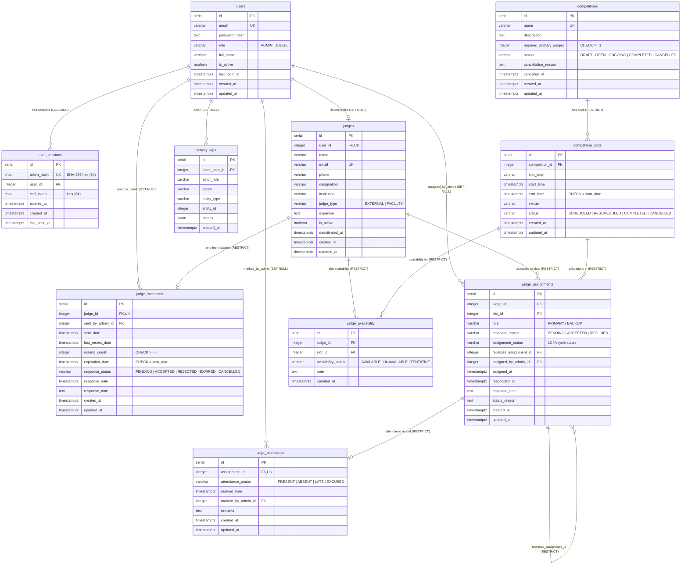

# BAUST CSE Fest – Judge Invitation & Allocation Management System

**Comprehensive System & Technical Documentation**

---

## Table of Contents

1. [Project Overview](#1-project-overview)
2. [User Roles & Permissions](#2-user-roles--permissions)
3. [Complete Feature List](#3-complete-feature-list)
4. [Complete Admin Workflow](#4-complete-admin-workflow)
5. [Complete Judge Workflow](#5-complete-judge-workflow)
6. [Invitation Lifecycle](#6-invitation-lifecycle)
7. [Assignment Lifecycle](#7-assignment-lifecycle)
8. [Backup & Replacement System](#8-backup--replacement-system)
9. [Attendance Management](#9-attendance-management)
10. [Competition & Slot Management](#10-competition--slot-management)
11. [Database Documentation](#11-database-documentation)
12. [Status Reference](#12-status-reference)
13. [Business Rules & Validations](#13-business-rules--validations)
14. [Exceptional Scenarios](#14-exceptional-scenarios)
15. [API Documentation](#15-api-documentation)
16. [Frontend Structure](#16-frontend-structure)
17. [Security](#17-security)
18. [Installation & Configuration](#18-installation--configuration)
19. [Testing](#19-testing)
20. [Known Limitations & Future Improvements](#20-known-limitations--future-improvements)

---

## 1. Project Overview

### Purpose & Objectives

The **BAUST CSE Fest – Judge Invitation & Allocation Management System** is a full-stack web application built to coordinate judge recruitment, fest-level invitations, multi-slot competition scheduling, primary and faculty backup allocation, overlap conflict prevention, competition-day attendance, and live replacement auditing for the BAUST CSE Fest.

Core objectives implemented in the system:

- **Eliminate public self-registration**: Only Fest Administrators provision judge profiles and portal accounts, issuing secure credentials directly.
- **Separate account creation from fest invitation**: Creating a judge profile and portal login does not automatically invite the judge; invitations are sent as an explicit administrative action with an enforceable deadline.
- **Guarantee scheduling integrity**: Prevent duplicate active assignments, prevent unaccepted/rejected/expired invitees from being assigned, enforce `FACULTY`-only backup designations, and block overlapping competition slots across both `PRIMARY` and `BACKUP` roles at both the API transaction layer and the PostgreSQL trigger layer.
- **Preserve complete historical and audit trails**: Declined, withdrawn, replaced, and cancelled records are never deleted; replacement chains (`replaces_assignment_id`), attendance rows, and `activity_logs` remain intact for reporting and accountability.

### Technologies & Architecture

| Layer | Technology / Implementation |
| --- | --- |
| **Frontend** | Pure **HTML5**, **CSS3** (`public/css/styles.css`), and **Vanilla JavaScript ES Modules** (`public/js/*.js`) with hash-based SPA routing. Zero React, Next.js, or other UI frameworks are used in the served application. |
| **Icons & Typography** | Local **Lucide** UMD bundle served from Express at `/vendor/lucide.min.js` (`node_modules/lucide/dist/umd/lucide.min.js`); **Plus Jakarta Sans** and **JetBrains Mono** via Google Fonts (`public/index.html`). |
| **Backend** | **Node.js** + **Express.js** (`express@^4.21.2`) + **TypeScript**, executed via `tsx` (`server.ts`, `server/app.ts`). |
| **Database** | **PostgreSQL** (hosted on **Supabase** via session/transaction pooler) accessed directly using parameterized queries through the `pg` driver (`server/db.ts`). |
| **Authentication & Security** | `bcrypt` (cost factor `12`), PostgreSQL-backed session tokens (`user_sessions`, SHA-256 hashed), HTTP-only partitioned cookies (`baust_sid`), per-session CSRF token (`X-CSRF-Token`) + `Origin` header validation, and strict `ADMIN` / `JUDGE` role isolation (`server/security.ts`). |
| **Background Scheduler** | `setInterval` loop in `server.ts` (every `60_000` ms, `timer.unref()`) running `expireOverdueInvitations()`, supplemented by on-demand expiration checks in invitation, judge, dashboard, and portal routes. |

### High-Level Architecture

```text
Browser (Vanilla JS SPA: public/index.html + public/js/*.js)
   │  Credentials (HTTP-only Cookie `baust_sid`) + `X-CSRF-Token`
   ▼
Express Server (server.ts -> server/app.ts)
   ├── Security & Middleware: headers, JSON (1MB), cookieParser, requireAuth, requireRole, verifyCsrfAndOrigin
   ├── REST API Routers (server/routes/*.ts)
   │     ├── /api/auth          (bootstrap, login, logout, session me, change-password)
   │     ├── /api/judges        (CRUD, bulk CSV import, credential reset, deactivate/reactivate)
   │     ├── /api/invitations   (list, bulk/single send, resend, cancel, expire-overdue)
   │     ├── /api/competitions  (list, detail, create, update, cascade cancel)
   │     ├── /api/slots         (list, detail, create, reschedule conflict check/resolution, cancel)
   │     ├── /api/assignments   (list, eligible roster, assign, withdraw, backup candidates, replace, late-arrival)
   │     ├── /api/attendance    (overview + records, upsert attendance mark with needsBackup detection)
   │     ├── /api/judge         (judge-scoped dashboard, profile, invitation, assignments, schedule, availability)
   │     └── /api               (dashboard summary, reports overview, activity logs, settings, admin creation)
   ├── Static Assets: /vendor/lucide.min.js + /public/* + SPA fallback -> public/index.html
   └── Background Task: 60s overdue invitation auto-expiration
   │  pg Pool (SSL, max 15, parameterized SQL + BEGIN/COMMIT/ROLLBACK + FOR UPDATE locks)
   ▼
PostgreSQL (Supabase) — 10 Core/Support Tables + schema_migrations + 2 Integrity Triggers
```

---

## 2. User Roles & Permissions

The system enforces two mutually exclusive user roles stored in `users.role`: **`ADMIN`** and **`JUDGE`**. Public self-registration is completely disabled (`POST /api/auth/setup-admin` permanently locks once one `ADMIN` account exists).

### `ADMIN` Capabilities

Authenticated administrators have full access to `/api/*` management endpoints and the `#/admin/*` SPA workspace:

- **Judge Management**: Create external (`EXTERNAL`) or internal BAUST faculty (`FACULTY`) judges manually or via CSV bulk import (up to 200 rows per upload); automatically provision linked `JUDGE` login accounts; edit judge profiles; generate/reset temporary passwords; deactivate and reactivate judges.
- **Invitation Management**: Send fest invitations (single or bulk) with expiration deadlines; monitor statuses; resend/reopen `PENDING`, `EXPIRED`, or `CANCELLED` invitations; cancel eligible invitations; trigger overdue expiration checks.
- **Competition & Slot Management**: Create and update competitions (`DRAFT`, `OPEN`, `ONGOING`, `COMPLETED`) with required primary judge quotas; create, reschedule (with conflict detection and optional auto-withdrawal), and cancel time slots; cancel entire competitions with cascading slot/assignment preservation.
- **Allocation, Backup & Replacement**: View eligible accepted judges with availability and overlap warnings; assign `PRIMARY` judges and `FACULTY` `BACKUP` judges; withdraw assignments; activate pre-assigned standby backups or dynamically assign conflict-free faculty replacements; resolve late arrivals after replacement (`KEEP_REPLACEMENT` or `RESTORE_ORIGINAL`).
- **Competition-Day Attendance**: Mark `PRESENT`, `ABSENT`, `LATE`, or `EXCUSED` for assigned judges and immediately launch backup replacement when a primary or activated backup is marked `ABSENT`.
- **Reporting, Audit & System Settings**: View live KPIs on the dashboard, inspect competition summaries, judge workloads, replacement histories, and `activity_logs` (with CSV export), create additional `ADMIN` accounts, and change their own password.

### `JUDGE` Capabilities

Authenticated judges are strictly confined to `/api/judge/*`, `/api/auth/change-password`, `/api/auth/me`, and `/api/auth/logout`, and the `#/judge/*` SPA workspace:

- **Dashboard**: View personal fest invitation state, pending/confirmed/standby/historical assignment counts, and upcoming active slots.
- **Fest Invitation Response**: View their single fest invitation (`PENDING`, `ACCEPTED`, `REJECTED`, `EXPIRED`, or `CANCELLED`) and `ACCEPT` or `REJECT` it (with an optional note) before the deadline.
- **Assignment Management**: View active/pending and historical assignments separately; `ACCEPT` or `DECLINE` pending assignments; `WITHDRAW` from active/confirmed/standby/activated-backup assignments with a reason.
- **Schedule & Slot Availability**: View their chronological timetable and declare per-slot availability (`AVAILABLE`, `UNAVAILABLE`, or `TENTATIVE`) across active fest slots.
- **Profile & Security**: Update their own `designation`, `institution`, `phone`, and `expertise` (name, email, and judge type are read-only for judges), and change their own password.

### Authentication, Authorization & Access Restrictions

- **Separate Login Tabs & `expectedRole`**: The login UI (`public/js/authViews.js`) switches between `#/admin/login` (`expectedRole: 'ADMIN'`) and `#/judge/login` (`expectedRole: 'JUDGE'`). Submitting valid `ADMIN` credentials on the Judge tab—or `JUDGE` credentials on the Admin tab—returns HTTP `403`.
- **Role Middleware**: Every `/api/judges`, `/api/invitations`, `/api/competitions`, `/api/slots`, `/api/assignments`, `/api/attendance`, and dashboard/report/settings route enforces `requireAuth`, `requireRole('ADMIN')`, and `verifyCsrfAndOrigin`.
- **Judge Ownership Isolation**: Every `/api/judge/*` route enforces `requireRole('JUDGE')` (which verifies `req.auth.judgeId` is linked) and scopes SQL queries to `req.auth.judgeId`. Responding to another judge's assignment ID returns `403 Forbidden`.
- **Immediate Deactivation Enforcement**: Both `loadAuthSession()` and `POST /api/auth/login` verify `users.is_active === true` and (for `JUDGE`) `judges.is_active === true`. Deactivating a judge deletes all rows in `user_sessions` for that user so active sessions fail immediately with `401`.

---

## 3. Complete Feature List

| Module | Implemented Features |
| --- | --- |
| **First-Run Bootstrap & Auth** | One-time web setup screen (`POST /api/auth/setup-admin`) when zero `ADMIN` accounts exist; CLI seeder (`db/seed.ts`); dual-portal login (`ADMIN` / `JUDGE`); password change (`POST /api/auth/change-password`); sign out. |
| **Judge Management** | Directory search (`q` across name, email, institution, designation) and filters (`judgeType`, `isActive`, `invitationStatus`); manual Add Judge modal; Edit Judge profile modal; per-judge detail view (`#/admin/judges/:id`) with assignments, availability, and 30 recent activity logs; deactivate/reactivate workflows. |
| **Automatic Judge Account Creation** | Creating a judge manually (`POST /api/judges`) or via CSV bulk import (`POST /api/judges/bulk-import`) automatically creates a linked `users` row (`role = 'JUDGE'`) with a `bcrypt`-hashed 14-character CSPRNG temporary password (or admin-specified password on manual create); one-time credential display modal with copy-to-clipboard; admin password reset / account backfill (`POST /api/judges/:id/account`) that revokes existing sessions. |
| **CSV Bulk Judge Import** | RFC-4180 compliant CSV parser (BOM-stripping, quoted fields, header aliases, 500 KB max, 200 rows max); downloadable sample CSV template; per-row field validation; duplicate email detection within CSV and against both `users` and `judges`; PostgreSQL `SAVEPOINT` per row; import summary strip + downloadable one-time credentials CSV + immediate "Send Invitations to Created" CTA. |
| **Invitation Management** | Multi-select bulk invite from Judges Directory (`Invite Selected` toolbar) or Invitations page; single-judge invite from Judge Detail or Credential modal; separate **Portal Account** and **Invitation Status** columns; future expiration deadline enforcement; resend/reopen (`POST /api/invitations/:id/resend`); cancel (`POST /api/invitations/:id/cancel`); automatic 60-second & request-time expiration (`EXPIRED`). |
| **Competition Management** | Create/edit competitions with unique name, description, `required_primary_judges` ($\ge 1$), and status (`DRAFT`, `OPEN`, `ONGOING`, `COMPLETED`); aggregated active slot, filled primary, standby backup, and vacant position metrics; cascade competition cancellation (`POST /api/competitions/:id/cancel`). |
| **Competition Slot Management** | Create time slots (`end_time > start_time`) with label, start/end timestamps, and venue; filter by competition and status; reschedule slots with conflict detection (`BLOCK` returning `409` with conflicting judges vs `WITHDRAW_CONFLICTING` auto-withdrawing conflicts); slot cancellation (`POST /api/slots/:id/cancel`). |
| **Judge Availability** | Judges declare `AVAILABLE`, `UNAVAILABLE`, or `TENTATIVE` per active slot in `#/judge/schedule`; displayed to admins in the Judge Allocation eligible roster and Backup Candidates modal, and on Judge Detail pages. |
| **Judge Allocation** | Slot selector with live primary coverage & standby backup KPIs; eligible accepted judge roster showing availability, active workload count, same-slot status, and real-time overlapping slot conflicts; one-click `PRIMARY` or `FACULTY`-only `BACKUP` assignment; capacity cap enforcement; admin assignment withdrawal. |
| **Assignment Confirmation** | Judges accept (`CONFIRMED` for primary, `STANDBY` for backup), decline pending assignments (`DECLINED`), or withdraw from active/confirmed assignments (`WITHDRAWN`) with mandatory reason notes in the modal. |
| **Backup & Replacement Management** | Pre-assigned `FACULTY` backups held in `STANDBY`; Replacement queue surfacing unreplaced withdrawn/declined primary seats (when slot still has vacancies) and unreplaced `ABSENT` assignments; two-tier replacement modal (1. pre-assigned `STANDBY` backups excluding `ABSENT`, 2. dynamic conflict-free `FACULTY` judges); `Mark Unavailable` for standby backups; replacement chain tracking (`replaces_assignment_id`) and late-arrival resolution (`KEEP_REPLACEMENT` vs `RESTORE_ORIGINAL`). |
| **Competition-Day Attendance** | Slot attendance & vacancy summary table; competition/slot filters; one-click `PRESENT`, `ABSENT`, `LATE`, `EXCUSED` marking; automatic prompt opening the backup replacement modal when marking a primary or activated backup judge `ABSENT`; inline `Activate Backup` and `Late Arrival` triggers. |
| **Dashboard, Reports & Settings** | 6 live KPI cards + slot coverage table + 15 recent activity events (`#/admin/dashboard`); 4-tab Reports & Audit Trail (`Competition Summary`, `Judge Workload`, `Replacement History`, `Activity Logs`) with client-side CSV export (`#/admin/reports`); System Settings showing active session/audit/migration counts, admin list, new admin creation, manual `Expire Overdue Invitations` button, and password update (`#/admin/settings`). |

---

## 4. Complete Admin Workflow

### Step 1: System Bootstrap & Administrator Sign-In

1. On a fresh database with zero `ADMIN` users (`GET /api/auth/status` returns `needsAdminSetup: true`), opening the application displays **Initialize Administrator Account** (`POST /api/auth/setup-admin`), or an admin can be created via CLI (`npm run db:seed`).
2. Once at least one admin exists, the admin navigates to `#/admin/login`, selects the **Admin Portal** tab, enters email and password, and signs in (`POST /api/auth/login` with `expectedRole: "ADMIN"`). The backend issues an HTTP-only `baust_sid` cookie and returns a CSRF token stored in memory.

### Step 2: Adding External & Faculty Judges (Automatic Account Provisioning)

Admins can add judges individually or in bulk—**neither action sends a fest invitation**:

- **Single Judge (`#/admin/judges` → `Add Judge`)**:
  1. Fill in **Full Name**, **Email Address**, **Phone Number** (optional), **Judge Type** (`EXTERNAL` or `FACULTY`), **Designation**, **Institution / Organization**, and **Areas of Expertise** (optional).
  2. By default, the system auto-generates a 14-character cryptographically random temporary password (guaranteed to contain uppercase, lowercase, digit, and symbol), hashes it with `bcrypt` (cost `12`), creates a `users` row (`role = 'JUDGE'`), and creates the `judges` row in a single transaction (`POST /api/judges`). Optionally, the admin may check **Specify a custom initial password** ($\ge 8$ chars).
  3. Duplicate email addresses (case-insensitive across both `users` and `judges`) are rejected with HTTP `409`.
  4. On success, the **Judge & Portal Account Created** modal displays the login email, one-time temporary password (with a **Copy Credentials** button), separate `ACCOUNT CREATED` and `NOT INVITED` badges, and an optional **Send Fest Invitation** button.
- **CSV Bulk Import (`#/admin/judges` → `Import CSV`)**:
  1. Download the sample CSV template (`baust-judges-sample.csv`) or upload/paste a `.csv` file (up to 500 KB and 200 rows) with headers `name, email, phone, judge_type, designation, institution, expertise`.
  2. Submitting calls `POST /api/judges/bulk-import`. Each valid, non-duplicate row creates both a `users` portal account and a `judges` profile with a unique 14-character temporary password.
  3. The import summary displays counts for **Total Rows**, **Created**, **Duplicates Skipped** (in-file and database duplicates), and **Validation Errors** (with row-level reasons), plus a **Download Credentials CSV** button and a **Send Invitations to Created** button.
- **Editing, Password Reset & Deactivation**:
  - Click **Edit** on any judge row or detail page to update profile fields (`PUT /api/judges/:id`), which also updates `users.email` and `users.full_name`.
  - Click **Reset PW** (or **Set Account** if `user_id` is null) to issue a new auto-generated or custom password (`POST /api/judges/:id/account`), immediately revoking all active sessions for that judge.
  - Click **Deactivate** (`PATCH /api/judges/:id/deactivate`) to disable portal access, terminate sessions, cancel any `PENDING` invitation, and move active/standby assignments to `CANCELLED_DEACTIVATED`.

### Step 3: Sending & Monitoring Fest Invitations

1. From `#/admin/judges` (using row checkboxes + **Invite Selected** / **Send Fest Invitations**), from `#/admin/invitations` (**Send Invitations**), or from a judge's detail/credential modal, select eligible active judges (`NOT_INVITED`, `EXPIRED`, or `CANCELLED`).
2. Pick a future **Response Deadline** and submit (`POST /api/invitations/send`).
3. Monitor responses on `#/admin/invitations` (filterable by status, judge type, and search query). Admins can **Resend** (`PENDING`, `EXPIRED`, or `CANCELLED` invitations with a new future deadline), **Cancel** (`PENDING`, or `ACCEPTED` only when zero active assignments exist), or click **Expire Overdue** (`POST /api/invitations/expire-overdue`).

### Step 4: Creating Competitions & Time Slots

1. Go to `#/admin/competitions` → **New Competition** (`POST /api/competitions`) to set the unique name, description, `requiredPrimaryJudges` ($\ge 1$), and initial status (`DRAFT`, `OPEN`, `ONGOING`, or `COMPLETED`).
2. Go to `#/admin/slots` (or click **Slots** on a competition) → **Add Slot** (`POST /api/slots`) to define `slotLabel`, `venue`, `startTime`, and `endTime` (`end_time > start_time`).

### Step 5: Allocating Primary & Backup Judges

1. Navigate to `#/admin/allocation` (or click **Allocate** on any slot/dashboard row).
2. Select a competition slot from the dropdown. The workspace displays **Primary Coverage** (`filled/required`), **Standby Faculty Backups**, current slot assignments, and **Eligible Accepted Judges** (only active judges whose invitation status is `ACCEPTED`).
3. Review each judge's declared **Slot Availability**, **Workload**, and **Conflict Check** (same-slot or overlapping time window).
4. Click **Primary** (`role: 'PRIMARY'`) to assign a primary judge (creates status `ASSIGNED`), or **Backup** (`role: 'BACKUP'`, shown only for `FACULTY` judges) to pre-assign a standby backup (creates status `STANDBY`).

### Step 6: Handling Withdrawals, Event-Day Attendance & Replacements

1. On competition day, open `#/admin/attendance` to monitor per-slot `Primary Filled`, `Vacant`, `Standby`, `Present`, `Absent`, and `Activated Backups`.
2. Mark each judge's attendance (`PRESENT`, `ABSENT`, `LATE`, or `EXCUSED`) via `POST /api/attendance/mark`.
3. If an active `PRIMARY` or `ACTIVATED_BACKUP` judge is marked `ABSENT`, the API returns `needsBackup: true` and the UI immediately opens the **Activate Backup / Replace Judge** modal (also accessible anytime from `#/admin/backups` under **Positions Needing Replacement**).
4. Choose either:
   - A **Pre-Assigned Standby Backup** (`backupAssignmentId`), provided that backup is not marked `ABSENT`, or
   - A **Dynamic Available Faculty Judge** (`facultyJudgeId`) who has accepted the fest invitation, is active, and has no overlapping assignments during that slot.
5. If a replaced judge later arrives on site, click **Late Arrival** in `#/admin/backups` or `#/admin/attendance` and choose `KEEP_REPLACEMENT` (recommended) or `RESTORE_ORIGINAL`.

### Step 7: Viewing Dashboard & Reports

- `#/admin/dashboard` shows 6 live KPI cards, **Competition Slot Coverage**, and the 15 most recent audit events.
- `#/admin/reports` provides 4 tabs (**Competition Summary**, **Judge Workload**, **Replacement History**, **Activity Logs**) with one-click **Export Current CSV** for each active tab.

---

## 5. Complete Judge Workflow

1. **Sign In (`#/judge/login`)**:
   - The judge enters the email and temporary/issued password provided by the Fest Administrator on the **Judge Portal** tab (`POST /api/auth/login` with `expectedRole: "JUDGE"`).
2. **Dashboard (`#/judge/dashboard`)**:
   - Displays a welcome banner, fest invitation alert banner (if `PENDING`, with deadline), 4 KPI cards (Fest Invitation status, Pending Confirmation count, Confirmed Judging Slots & Standby count, Past/Exception Records count), and the **Upcoming Assigned Slots** table.
3. **Respond to Fest Invitation (`#/judge/invitations`)**:
   - Judges see who invited them, Sent Date, Response Deadline, and Response Date.
   - If status is `PENDING`, they can enter an optional **Note to Organizing Committee** and click **Accept Invitation** (`ACCEPTED`) or **Decline / Reject Invitation** (`REJECTED`) via `POST /api/judge/invitation/respond`.
   - If the deadline has already elapsed, the system auto-expires the invitation to `EXPIRED` and returns HTTP `409`.
4. **Respond to Slot Assignments (`#/judge/assignments`)**:
   - View **Active & Pending** and **Historical & Closed** tabs (`GET /api/judge/assignments`).
   - For `PENDING` assignments (`ASSIGNED` or `STANDBY`): click **Accept** (`CONFIRMED` for primary, `STANDBY` for backup) or **Decline** (opens modal requiring a reason note, setting `DECLINED`).
   - For active/confirmed/standby/activated-backup assignments: click **Withdraw** (opens modal requiring a reason note, setting `WITHDRAWN`).
5. **Check Schedule & Declare Availability (`#/judge/schedule`)**:
   - **My Assigned Timetable** lists all active/standby non-cancelled assignments in chronological order (`GET /api/judge/schedule`).
   - **Declare Slot Availability** lists all active competition slots and lets the judge toggle **Available** (`AVAILABLE`), **Tentative** (`TENTATIVE`), or **Unavailable** (`UNAVAILABLE`) via `POST /api/judge/availability`.
6. **Profile & Password (`#/judge/profile`)**:
   - Update `designation`, `institution`, `phone`, and `expertise` (`PUT /api/judge/profile`). Name, email, and judge type are read-only.
   - Change password (`POST /api/auth/change-password`) by supplying current password and new password ($\ge 8$ characters).

---

## 6. Invitation Lifecycle

The `judge_invitations` table enforces a strict **`UNIQUE (judge_id)`** constraint—there is **at most one fest invitation record per judge** for the fest. Judges without a row in `judge_invitations` are displayed in the UI as **`NOT_INVITED`**.

### Invitation Statuses

| Status | Meaning |
| --- | --- |
| `NOT_INVITED` *(UI state)* | Judge profile exists (`judges`), no row exists yet in `judge_invitations`. |
| `PENDING` | Invitation sent or reopened; awaiting judge response before `expiration_date`. |
| `ACCEPTED` | Judge accepted the fest invitation; eligible for slot assignments (`PRIMARY`, and `BACKUP` if `FACULTY`). |
| `REJECTED` | Judge declined the fest invitation; blocked from receiving any assignments. |
| `EXPIRED` | `expiration_date <= NOW()` elapsed while status was `PENDING`. |
| `CANCELLED` | Cancelled by an admin (`POST /api/invitations/:id/cancel`) or automatically cancelled when a judge with a `PENDING` invitation is deactivated. |

### Invitation State Transitions

```text
[NOT_INVITED] ──(Admin sends: POST /api/invitations/send)──▶ [PENDING]
                                                                │
       ┌────────────────────────┬───────────────────────────────┼───────────────────────┐
       ▼                        ▼                               ▼                       ▼
(Judge accepts)         (Judge rejects)         (NOW() >= expiration_date)     (Admin cancels or
       │                        │                via 60s timer / API check)     deactivates judge)
       ▼                        ▼                               ▼                       ▼
  [ACCEPTED]               [REJECTED]                       [EXPIRED]              [CANCELLED]
       │                                                        │                       │
       └─(Admin cancels ONLY if 0 active assignments)───────────┴───(Admin Resends / Reopens with future deadline)──▶ [PENDING]
                                                                    (increments resend_count, updates last_resent_date)
```

### Expiration, Cancellation & Resending Rules

- **Automatic Expiration (`expireOverdueInvitations`)**: Runs every 60 seconds in `server.ts` and inline at the start of `GET /api/judges`, `GET /api/judges/:id`, `GET /api/invitations`, `POST /api/invitations/send`, `POST /api/invitations/:id/resend`, `GET /api/dashboard/summary`, `GET /api/reports/overview`, `GET /api/judge/dashboard`, `GET /api/judge/invitation`, and `POST /api/judge/invitation/respond`. Transitions `PENDING` rows with `expiration_date <= NOW()` to `EXPIRED` and logs `INVITATION_AUTO_EXPIRED` with `actorRole: 'SYSTEM'`.
- **Resending / Reopening**: Allowed via `POST /api/invitations/:id/resend` when status is `PENDING`, `EXPIRED`, or `CANCELLED` (and via `POST /api/invitations/send` for `EXPIRED` or `CANCELLED`), provided the judge is active and the new `expirationDate` is strictly in the future. Increments `resend_count` and sets `last_resent_date = NOW()`. Blocked (`409`) if already `ACCEPTED` or `REJECTED`.
- **Cancellation**: Allowed via `POST /api/invitations/:id/cancel` unless already `CANCELLED`, already `REJECTED`, or the judge currently holds any active/standby assignment (`ASSIGNED`, `CONFIRMED`, `STANDBY`, `ACTIVATED_BACKUP`).

---

## 7. Assignment Lifecycle

Each row in `judge_assignments` tracks two complementary fields:
- `response_status`: Judge's personal response to the specific slot assignment (`PENDING`, `ACCEPTED`, `DECLINED`).
- `assignment_status`: Operational lifecycle state (`ASSIGNED`, `CONFIRMED`, `DECLINED`, `WITHDRAWN`, `REPLACED`, `STANDBY`, `ACTIVATED_BACKUP`, `CANCELLED_SLOT`, `CANCELLED_DEACTIVATED`, `COMPLETED`).

### Active vs. Historical States

- **Active / Occupying States** (enforced by partial unique index `uq_active_judge_slot_assignment` and overlap trigger): `ASSIGNED`, `CONFIRMED`, `STANDBY`, `ACTIVATED_BACKUP`.
- **Primary Quota Counting States**: A slot's `filled_primary_count` counts assignments where `(role = 'PRIMARY' AND assignment_status IN ('ASSIGNED', 'CONFIRMED')) OR assignment_status = 'ACTIVATED_BACKUP'`.
- **Historical / Released States** (preserved permanently; free up the slot and time window for reassignment): `DECLINED`, `WITHDRAWN`, `REPLACED`, `CANCELLED_SLOT`, `CANCELLED_DEACTIVATED`, `COMPLETED`.

### Primary & Backup Transitions

```text
Admin assigns PRIMARY ──▶ (response_status='PENDING', assignment_status='ASSIGNED')
   ├── Judge ACCEPT   ──▶ (response_status='ACCEPTED', assignment_status='CONFIRMED')
   ├── Judge DECLINE  ──▶ (response_status='DECLINED', assignment_status='DECLINED')
   ├── Judge/Admin WITHDRAW / Reschedule Auto-Withdraw ──▶ assignment_status='WITHDRAWN'
   ├── Admin Replace  ──▶ assignment_status='REPLACED'  (link via replacement's replaces_assignment_id)
   │     └── Late Arrival RESTORE_ORIGINAL ──▶ assignment_status='CONFIRMED'
   ├── Slot/Comp Cancel ──▶ assignment_status='CANCELLED_SLOT'
   └── Judge Deactivate ──▶ assignment_status='CANCELLED_DEACTIVATED'

Admin assigns BACKUP (FACULTY only) ──▶ (response_status='PENDING', assignment_status='STANDBY')
   ├── Judge ACCEPT   ──▶ (response_status='ACCEPTED', assignment_status='STANDBY')
   ├── Judge DECLINE  ──▶ (response_status='DECLINED', assignment_status='DECLINED')
   ├── Judge/Admin WITHDRAW / Mark Unavailable ──▶ assignment_status='WITHDRAWN'
   ├── Activated as Replacement ──▶ (response_status='ACCEPTED', assignment_status='ACTIVATED_BACKUP', replaces_assignment_id=<orig>)
   │     └── Late Arrival RESTORE_ORIGINAL ──▶ (assignment_status='STANDBY', replaces_assignment_id=NULL)
   ├── Slot/Comp Cancel ──▶ assignment_status='CANCELLED_SLOT'
   └── Judge Deactivate ──▶ assignment_status='CANCELLED_DEACTIVATED'
```

*(Note: `COMPLETED` is a valid `CHECK`-constrained status in `judge_assignments.assignment_status`, representing finished historical assignments.)*

---

## 8. Backup & Replacement System

The backup system ensures every competition slot maintains its required primary judge quorum even during sudden withdrawals, declines, or event-day absences.

### 1. Pre-Assigned Faculty Backups (`STANDBY`)

- Only active judges with `judge_type = 'FACULTY'` and `ACCEPTED` fest invitations can be assigned with `role = 'BACKUP'`.
- Pre-assigned backups start in `assignment_status = 'STANDBY'`. They **do not** consume primary seat capacity, **but they are checked for time-window overlaps** just like primary judges so a faculty member cannot be double-booked across parallel competitions.

### 2. Replacement Queue & Vacancy Rules

On `#/admin/backups`, **Positions Needing Replacement** (`needingReplacement`) lists non-cancelled assignments without an active replacement where either:
1. A `PRIMARY` assignment is `WITHDRAWN` or `DECLINED` **and** the slot still has `slot_vacant_positions > 0` (meaning if an admin manually assigns a new `PRIMARY` judge to fill that vacancy, the old declined/withdrawn record drops off the replacement queue automatically), **or**
2. An active assignment (`ASSIGNED`, `CONFIRMED`, or `ACTIVATED_BACKUP`) has attendance marked `ABSENT` and has not yet been `REPLACED`.

### 3. Two-Tier Replacement Selection (`GET /api/assignments/:id/backup-candidates`)

When replacing an assignment (`POST /api/assignments/:id/replace`):
- **Tier 1 — Pre-Assigned Standby Backups**: Lists all active `FACULTY` judges on `STANDBY` for that same `slot_id`, ordered with non-absent and `ACCEPTED` backups first. Attempting to activate a standby backup whose attendance is `ABSENT` is rejected with HTTP `409`. Activating updates the standby row to `assignment_status = 'ACTIVATED_BACKUP'`, `response_status = 'ACCEPTED'`, and sets `replaces_assignment_id` to the original assignment ID.
- **Tier 2 — Dynamic Faculty Fallback**: Lists all active `FACULTY` judges with `ACCEPTED` invitations who have no active/standby assignment in the same slot and no overlapping active assignments during `[slot.start_time, slot.end_time]`, ranked by availability (`AVAILABLE` → `UNSPECIFIED` → `TENTATIVE` → `UNAVAILABLE`) and lowest `active_assignments_count`. Activating inserts a new `judge_assignments` row (`role = 'BACKUP'`, `response_status = 'ACCEPTED'`, `assignment_status = 'ACTIVATED_BACKUP'`, `replaces_assignment_id = targetAssignmentId`).
- **Original Record Preservation**: In both modes, the original assignment transitions to `assignment_status = 'REPLACED'` (preserving its attendance record and `status_reason`). Partial unique index `uq_single_active_replacement` guarantees an assignment cannot have two concurrent active replacements.

### 4. Handling Absent/Unavailable Backups & Late Arrivals

- **Absent/Unavailable Standby Backup**: Admins can mark a standby backup `ABSENT` in Attendance or click **Mark Unavailable** (`POST /api/assignments/:id/withdraw`) in Backup Management, then fall back to another standby or dynamic faculty judge.
- **Chained Replacement**: If an `ACTIVATED_BACKUP` judge is subsequently marked `ABSENT`, they can themselves be replaced via the same `/replace` workflow (`assignment_status !== 'REPLACED'` allows chaining).
- **Late Arrival Resolution (`POST /api/assignments/:id/late-arrival`)**: When a `REPLACED` judge arrives late while an active replacement exists:
  - `KEEP_REPLACEMENT`: Upserts `judge_attendance` on the original assignment to `LATE` with remarks; leaves the original `REPLACED` and the backup `ACTIVATED_BACKUP`.
  - `RESTORE_ORIGINAL`: Upserts `judge_attendance` on the original assignment to `LATE`; returns the backup assignment to `STANDBY` with `replaces_assignment_id = NULL`; restores the original assignment to `CONFIRMED`.

---

## 9. Attendance Management

Tracked in `judge_attendance` with a `UNIQUE (assignment_id)` constraint (one attendance record per assignment, updated via PostgreSQL `ON CONFLICT (assignment_id) DO UPDATE`).

### Implemented Capabilities

- **Allowed Statuses**: `PRESENT`, `ABSENT`, `LATE`, `EXCUSED`.
- **Eligible Assignments**: Attendance can be marked on non-cancelled slots/competitions for assignments in `ASSIGNED`, `CONFIRMED`, `STANDBY`, `ACTIVATED_BACKUP`, `REPLACED`, or `WITHDRAWN` (blocked with `409` for `DECLINED`, `CANCELLED_SLOT`, or `CANCELLED_DEACTIVATED`).
- **Automated Backup Trigger**: When marking `attendanceStatus = 'ABSENT'` on an unreplaced `PRIMARY` or `ACTIVATED_BACKUP` assignment, `POST /api/attendance/mark` returns `needsBackup: true`, prompting the Attendance UI (`public/js/adminOperationsViews.js`) to immediately open the backup replacement modal.
- **Slot Attendance & Vacancy Summary**: `GET /api/attendance` computes per-slot `filled_primary`, `vacant_positions` ($\max(0, \text{required} - \text{filled})$), `standby_backups`, `present_count`, `absent_count`, and `activated_replacements_count`.

---

## 10. Competition & Slot Management

### Competitions (`competitions`)

- Each competition has a unique `name`, optional `description`, `required_primary_judges` ($\ge 1$), and `status` (`DRAFT`, `OPEN`, `ONGOING`, `COMPLETED`, `CANCELLED`).
- Editing a `CANCELLED` competition via `PUT /api/competitions/:id` is blocked (`409`). Setting status to `CANCELLED` must go through `POST /api/competitions/:id/cancel`.
- Cancelling a competition locks the competition row, transitions it to `CANCELLED` (recording `cancellation_reason` and `cancelled_at`), cancels all non-cancelled `competition_slots`, and transitions all active/standby `judge_assignments` in those slots to `CANCELLED_SLOT`—preserving every historical assignment and attendance row.

### Competition Slots (`competition_slots`)

- A competition can have multiple slots (e.g., Preliminary Round, Final Round, Track A / Track B), each with `slot_label`, `start_time`, `end_time` (`CHECK (end_time > start_time)`), `venue`, and `status` (`SCHEDULED`, `RESCHEDULED`, `COMPLETED`, `CANCELLED`).
- **Rescheduling & Conflict Detection (`PUT /api/slots/:id`)**:
  - When updating a slot, the backend detects any judge with an active/standby assignment (`ASSIGNED`, `CONFIRMED`, `STANDBY`, `ACTIVATED_BACKUP`) on this slot who also has another active/standby assignment in a non-cancelled slot whose time window overlaps (`cs2.start_time < new_end AND cs2.end_time > new_start`).
  - With `conflictResolution: 'BLOCK'` (default), the endpoint returns HTTP `409` with `details.conflicts` listing every conflicting judge and slot.
  - With `conflictResolution: 'WITHDRAW_CONFLICTING'`, the endpoint sets those conflicting assignments on the rescheduled slot to `WITHDRAWN` (`status_reason: 'Automatically withdrawn due to slot reschedule conflict'`) before updating the slot timestamps.
  - If `start_time` or `end_time` changed and the slot is not `COMPLETED`, status transitions to `RESCHEDULED`.
- **Slot Cancellation (`POST /api/slots/:id/cancel`)**: Transitions the slot to `CANCELLED` and releases active/standby assignments to `CANCELLED_SLOT`.

---

## 11. Database Documentation

The canonical schema is defined in `schema.sql` and applied transactionally via `db/migrations/001_initial_schema.sql` using `db/migrate.ts`.

### Entity Relationship Diagram



### Table-by-Table Reference

#### 1. `schema_migrations` *(created by `db/migrate.ts`)*
Tracks executed SQL migration files so migrations run exactly once.
- **Columns**: `id` (`SERIAL PK`), `filename` (`VARCHAR(255) NOT NULL UNIQUE`), `applied_at` (`TIMESTAMPTZ NOT NULL DEFAULT NOW()`).

#### 2. `users`
Authentication credentials and RBAC role assignment (`ADMIN` or `JUDGE`).
- **Columns**: `id` (`SERIAL PK`), `email` (`VARCHAR(255) NOT NULL UNIQUE`), `password_hash` (`TEXT NOT NULL`), `role` (`VARCHAR(20) NOT NULL CHECK IN ('ADMIN','JUDGE')`), `full_name` (`VARCHAR(255) NOT NULL`), `is_active` (`BOOLEAN NOT NULL DEFAULT TRUE`), `last_login_at` (`TIMESTAMPTZ`), `created_at`, `updated_at`.

#### 3. `user_sessions`
Server-side HTTP-only login sessions and per-session CSRF tokens (7-day TTL).
- **Columns**: `id` (`SERIAL PK`), `token_hash` (`CHAR(64) NOT NULL UNIQUE`), `user_id` (`INTEGER NOT NULL FK -> users(id) ON DELETE CASCADE`), `csrf_token` (`CHAR(64) NOT NULL`), `expires_at` (`TIMESTAMPTZ NOT NULL`), `created_at`, `last_seen_at`.
- **Indexes**: `idx_user_sessions_user_id(user_id)`, `idx_user_sessions_expires_at(expires_at)`.

#### 4. `judges`
Domain profile for external and BAUST faculty judges.
- **Columns**: `id` (`SERIAL PK`), `user_id` (`INTEGER UNIQUE FK -> users(id) ON DELETE SET NULL`), `name` (`VARCHAR(255) NOT NULL`), `email` (`VARCHAR(255) NOT NULL UNIQUE`), `phone` (`VARCHAR(50)`), `designation` (`VARCHAR(255) NOT NULL`), `institution` (`VARCHAR(255) NOT NULL`), `judge_type` (`VARCHAR(20) NOT NULL CHECK IN ('EXTERNAL','FACULTY')`), `expertise` (`TEXT`), `is_active` (`BOOLEAN NOT NULL DEFAULT TRUE`), `deactivated_at` (`TIMESTAMPTZ`), `created_at`, `updated_at`.
- **Indexes**: `idx_judges_type_active(judge_type, is_active)`.

#### 5. `competitions`
Fest competitions and primary judge requirements per slot.
- **Columns**: `id` (`SERIAL PK`), `name` (`VARCHAR(255) NOT NULL UNIQUE`), `description` (`TEXT`), `required_primary_judges` (`INTEGER NOT NULL CHECK >= 1`), `status` (`VARCHAR(20) NOT NULL DEFAULT 'DRAFT' CHECK IN ('DRAFT','OPEN','ONGOING','COMPLETED','CANCELLED')`), `cancellation_reason` (`TEXT`), `cancelled_at` (`TIMESTAMPTZ`), `created_at`, `updated_at`.
- **Indexes**: `idx_competitions_status(status)`.

#### 6. `competition_slots`
Scheduled judging time windows and venues belonging to a competition.
- **Columns**: `id` (`SERIAL PK`), `competition_id` (`INTEGER NOT NULL FK -> competitions(id) ON DELETE RESTRICT`), `slot_label` (`VARCHAR(150) NOT NULL`), `start_time` (`TIMESTAMPTZ NOT NULL`), `end_time` (`TIMESTAMPTZ NOT NULL`), `venue` (`VARCHAR(255) NOT NULL`), `status` (`VARCHAR(20) NOT NULL DEFAULT 'SCHEDULED' CHECK IN ('SCHEDULED','RESCHEDULED','COMPLETED','CANCELLED')`), `created_at`, `updated_at`.
- **Constraints & Indexes**: `chk_slot_valid_times CHECK (end_time > start_time)`, `idx_competition_slots_comp(competition_id)`, `idx_competition_slots_window(start_time, end_time)`.

#### 7. `judge_invitations`
Single fest-wide invitation per judge with deadline tracking and resend metrics.
- **Columns**: `id` (`SERIAL PK`), `judge_id` (`INTEGER NOT NULL UNIQUE FK -> judges(id) ON DELETE RESTRICT`), `sent_by_admin_id` (`INTEGER FK -> users(id) ON DELETE SET NULL`), `sent_date` (`TIMESTAMPTZ NOT NULL DEFAULT NOW()`), `last_resent_date` (`TIMESTAMPTZ`), `resend_count` (`INTEGER NOT NULL DEFAULT 0 CHECK >= 0`), `expiration_date` (`TIMESTAMPTZ NOT NULL`), `response_status` (`VARCHAR(20) NOT NULL DEFAULT 'PENDING' CHECK IN ('PENDING','ACCEPTED','REJECTED','EXPIRED','CANCELLED')`), `response_date` (`TIMESTAMPTZ`), `response_note` (`TEXT`), `created_at`, `updated_at`.
- **Constraints & Indexes**: `chk_invitation_dates CHECK (expiration_date > sent_date)`, `idx_judge_invitations_status(response_status, expiration_date)`.

#### 8. `judge_availability`
Optional per-slot availability declared by judges.
- **Columns**: `id` (`SERIAL PK`), `judge_id` (`INTEGER NOT NULL FK -> judges(id) ON DELETE RESTRICT`), `slot_id` (`INTEGER NOT NULL FK -> competition_slots(id) ON DELETE RESTRICT`), `availability_status` (`VARCHAR(20) NOT NULL DEFAULT 'AVAILABLE' CHECK IN ('AVAILABLE','UNAVAILABLE','TENTATIVE')`), `note` (`TEXT`), `updated_at` (`TIMESTAMPTZ NOT NULL DEFAULT NOW()`).
- **Constraints**: `uq_judge_slot_availability UNIQUE (judge_id, slot_id)`.

#### 9. `judge_assignments`
Primary and backup slot allocations, preserving full historical and replacement records.
- **Columns**: `id` (`SERIAL PK`), `judge_id` (`INTEGER NOT NULL FK -> judges(id) ON DELETE RESTRICT`), `slot_id` (`INTEGER NOT NULL FK -> competition_slots(id) ON DELETE RESTRICT`), `role` (`VARCHAR(20) NOT NULL CHECK IN ('PRIMARY','BACKUP')`), `response_status` (`VARCHAR(20) NOT NULL DEFAULT 'PENDING' CHECK IN ('PENDING','ACCEPTED','DECLINED')`), `assignment_status` (`VARCHAR(30) NOT NULL DEFAULT 'ASSIGNED' CHECK IN ('ASSIGNED','CONFIRMED','DECLINED','WITHDRAWN','REPLACED','STANDBY','ACTIVATED_BACKUP','CANCELLED_SLOT','CANCELLED_DEACTIVATED','COMPLETED')`), `replaces_assignment_id` (`INTEGER FK -> judge_assignments(id) ON DELETE RESTRICT`), `assigned_by_admin_id` (`INTEGER FK -> users(id) ON DELETE SET NULL`), `assigned_at`, `responded_at`, `response_note`, `status_reason`, `created_at`, `updated_at`.
- **Constraints & Indexes**:
  - `chk_no_self_replacement CHECK (replaces_assignment_id IS NULL OR replaces_assignment_id <> id)`
  - Partial unique index `uq_active_judge_slot_assignment ON (judge_id, slot_id) WHERE assignment_status IN ('ASSIGNED', 'CONFIRMED', 'STANDBY', 'ACTIVATED_BACKUP')` — allows a judge to be re-assigned to a slot later if an earlier attempt was `DECLINED`/`WITHDRAWN`, while preventing duplicate concurrent active rows.
  - Partial unique index `uq_single_active_replacement ON (replaces_assignment_id) WHERE replaces_assignment_id IS NOT NULL AND assignment_status IN ('ASSIGNED', 'CONFIRMED', 'ACTIVATED_BACKUP')` — ensures an original assignment cannot have two active replacements simultaneously.
  - `idx_judge_assignments_slot(slot_id, assignment_status)`, `idx_judge_assignments_judge(judge_id, assignment_status)`.

#### 10. `judge_attendance`
Event-day attendance for each assignment.
- **Columns**: `id` (`SERIAL PK`), `assignment_id` (`INTEGER NOT NULL UNIQUE FK -> judge_assignments(id) ON DELETE RESTRICT`), `attendance_status` (`VARCHAR(20) NOT NULL CHECK IN ('PRESENT','ABSENT','LATE','EXCUSED')`), `marked_time`, `marked_by_admin_id` (`INTEGER FK -> users(id) ON DELETE SET NULL`), `remarks`, `created_at`, `updated_at`.

#### 11. `activity_logs`
Append-only audit trail for admin, judge, and system actions.
- **Columns**: `id` (`SERIAL PK`), `actor_user_id` (`INTEGER FK -> users(id) ON DELETE SET NULL`), `actor_role` (`VARCHAR(20)`), `action` (`VARCHAR(100) NOT NULL`), `entity_type` (`VARCHAR(50) NOT NULL`), `entity_id` (`INTEGER`), `details` (`JSONB NOT NULL DEFAULT '{}'`), `created_at`.
- **Indexes**: `idx_activity_logs_entity(entity_type, entity_id)`, `idx_activity_logs_created_at(created_at DESC)`.

### Database Triggers (`schema.sql`)

| Trigger / Function | Timing & Target | Enforced Invariants & Error Codes |
| --- | --- | --- |
| `trg_validate_judge_assignment` (`fn_validate_judge_assignment`) | `BEFORE INSERT OR UPDATE` on `judge_assignments` | Fires whenever `NEW.assignment_status IN ('ASSIGNED','CONFIRMED','STANDBY','ACTIVATED_BACKUP')`:<br>• `P0001` (`400`): Judge must exist and `is_active = TRUE`.<br>• `P0002` (`400`): `role = 'BACKUP'` requires `judge_type = 'FACULTY'`.<br>• `P0003` (`400`): Judge must have an `ACCEPTED` row in `judge_invitations`.<br>• `P0004` (`400`): Slot and competition must exist and neither can be `CANCELLED`.<br>• `P0005` (`409`): Judge cannot have another active/standby assignment whose non-cancelled slot overlaps `[v_slot_start, v_slot_end]`. |
| `trg_validate_slot_reschedule` (`fn_validate_slot_reschedule`) | `BEFORE UPDATE OF start_time, end_time, status` on `competition_slots` | Fires when `NEW.status <> 'CANCELLED'` and `start_time` or `end_time` changes:<br>• `P0006` (`409`): Blocks any silent time change that creates an overlapping active/standby assignment for any judge assigned to that slot. |

---

## 12. Status Reference

### Invitation Statuses (`judge_invitations.response_status`)
| Status | Description |
| --- | --- |
| `NOT_INVITED` *(UI-derived)* | No row exists in `judge_invitations` for this judge yet. |
| `PENDING` | Sent or reopened; waiting for judge decision prior to `expiration_date`. |
| `ACCEPTED` | Judge accepted participation in the fest; eligible for slot allocation. |
| `REJECTED` | Judge declined participation in the fest. |
| `EXPIRED` | Passed `expiration_date` without a response; automatically updated. |
| `CANCELLED` | Cancelled by an admin or upon judge deactivation while `PENDING`. |

### Assignment Statuses (`judge_assignments.assignment_status`)
| Status | Role Scope | Active/Occupying? | Meaning |
| --- | --- | --- | --- |
| `ASSIGNED` | `PRIMARY` | Yes | Assigned by admin; judge has not yet confirmed/declined. Counts toward filled primary seats. |
| `CONFIRMED` | `PRIMARY` | Yes | Primary judge accepted the slot assignment (or restored after late arrival). |
| `STANDBY` | `BACKUP` | Yes (occupies time window) | Pre-assigned `FACULTY` backup on standby (or returned to standby on `RESTORE_ORIGINAL`). |
| `ACTIVATED_BACKUP` | `BACKUP` | Yes | Backup judge activated to replace an original judge (`replaces_assignment_id` set). Counts toward filled primary seats. |
| `DECLINED` | Either | No (Historical) | Judge declined a `PENDING` assignment. |
| `WITHDRAWN` | Either | No (Historical) | Judge or admin withdrew an assignment, or auto-withdrawn on reschedule conflict. |
| `REPLACED` | Either | No (Historical) | Original assignment replaced by an `ACTIVATED_BACKUP`. Preserves attendance (`ABSENT`/`LATE`). |
| `CANCELLED_SLOT` | Either | No (Historical) | Assignment released because its competition or slot was cancelled. |
| `CANCELLED_DEACTIVATED` | Either | No (Historical) | Assignment released because the judge account was deactivated. |
| `COMPLETED` | Either | No (Historical) | Schema-defined completed assignment state. |

### Assignment Response (`judge_assignments.response_status`)
| Status | Meaning |
| --- | --- |
| `PENDING` | Awaiting judge acceptance or decline of the individual slot assignment. |
| `ACCEPTED` | Judge accepted (or admin activated them as backup). |
| `DECLINED` | Judge declined the pending slot assignment. |

### Availability (`judge_availability.availability_status`)
| Status | Meaning |
| --- | --- |
| `AVAILABLE` | Judge indicated availability for the slot. |
| `TENTATIVE` | Judge indicated tentative/uncertain availability. |
| `UNAVAILABLE` | Judge indicated unavailability for the slot. |
| `UNSPECIFIED` *(UI-derived)* | Judge has not yet declared availability for the slot. |

### Attendance (`judge_attendance.attendance_status`)
| Status | Meaning |
| --- | --- |
| `PRESENT` | Judge checked in and attended the slot. |
| `ABSENT` | Judge did not attend; triggers `needsBackup: true` for primary/activated-backup roles. |
| `LATE` | Judge arrived late (also recorded automatically during late-arrival resolution). |
| `EXCUSED` | Absence formally excused by administrator. |

### Competition (`competitions.status`), Slot (`competition_slots.status`), & Portal Account (`UI`)
- **Competition**: `DRAFT`, `OPEN`, `ONGOING`, `COMPLETED`, `CANCELLED`.
- **Slot**: `SCHEDULED`, `RESCHEDULED`, `COMPLETED`, `CANCELLED`.
- **Portal Account *(UI-derived in `adminJudgesViews.js`)***: `ACCOUNT_CREATED` (`has_account && is_active && user_is_active`), `ACCOUNT_DISABLED`, `NO_ACCOUNT`.

---

## 13. Business Rules & Validations

1. **Email Uniqueness**: Creating or updating a judge checks case-insensitive uniqueness (`LOWER(email)`) across both `users` and `judges`.
2. **Account Creation vs. Invitation Separation**: `POST /api/judges` and `POST /api/judges/bulk-import` create a `users` login account and a `judges` profile **only**. They never insert rows into `judge_invitations`.
3. **One Fest Invitation Per Judge**: Enforced via `UNIQUE (judge_id)` on `judge_invitations`. Re-inviting an `EXPIRED` or `CANCELLED` judge reopens their existing record and increments `resend_count`.
4. **Eligibility for Slot Allocation**: Only active judges (`judges.is_active = TRUE`) with `judge_invitations.response_status = 'ACCEPTED'` can be assigned (`PRIMARY` or `BACKUP`).
5. **Faculty-Only Backups & Type Lock**: Only judges with `judge_type = 'FACULTY'` can hold `role = 'BACKUP'` assignments. Editing a judge from `FACULTY` to `EXTERNAL` is blocked (`409`) if they hold any active/standby `BACKUP` assignment.
6. **Primary Capacity Cap**: Primary assignments (`(role = 'PRIMARY' AND assignment_status IN ('ASSIGNED','CONFIRMED')) OR assignment_status = 'ACTIVATED_BACKUP'`) cannot exceed `competitions.required_primary_judges` for a slot (`409`).
7. **Zero Overlapping Assignments**: Overlapping time windows (`cs.start_time < slot_end AND cs.end_time > slot_start`) across non-cancelled slots are blocked for both `PRIMARY` and `BACKUP` roles by API checks (`FOR UPDATE` locking) and `fn_validate_judge_assignment`.
8. **Strict History Preservation**: `ON DELETE RESTRICT` foreign keys on judges, competitions, slots, invitations, assignments, and attendance guarantee that operational records cannot be casually deleted; withdrawals, replacements, cancellations, and deactivations only transition statuses.
9. **Transactional Atomicity**: Multi-step mutations run inside `withTransaction()` (`BEGIN`/`COMMIT`/`ROLLBACK`) with row-level `FOR UPDATE` locks; CSV bulk import uses per-row `SAVEPOINT bulk_judge_row` so a race duplicate on one row does not abort valid sibling rows.

---

## 14. Exceptional Scenarios

All 13 exceptional scenarios below are implemented and verified end-to-end by `tests/verify_all_scenarios.ts`:

| # | Scenario | System Behavior & Resulting Database State |
| --- | --- | --- |
| **1** | **Judge accepts fest invitation, never assigned to any slot** | `judge_invitations.response_status = 'ACCEPTED'`; zero `judge_assignments` rows. Judge appears in eligible rosters and sees an empty upcoming timetable without errors. |
| **2** | **Judge rejects fest invitation** | `judge_invitations.response_status = 'REJECTED'`. Assigning this judge returns HTTP `400` from API and `P0003` from DB trigger. |
| **3** | **Judge does not respond before invitation deadline** | 60s background timer or request-time `expireOverdueInvitations()` updates `PENDING` rows past `expiration_date` to `EXPIRED`. Subsequent acceptance attempt returns `409`. Admin may resend with a new future deadline. |
| **4** | **Judge accepts fest invitation, then declines an individual slot assignment** | Assignment transitions to `response_status = 'DECLINED'`, `assignment_status = 'DECLINED'`. Primary seat becomes vacant; record preserved in history; replacement queue surfaces slot until filled. |
| **5** | **Judge accepts assignment (`CONFIRMED`), then later withdraws** | Judge or admin submits `WITHDRAW` with reason -> `assignment_status = 'WITHDRAWN'`. Primary seat becomes vacant; original confirmation/withdrawal history remains intact. |
| **6** | **Judge confirms assignment, then does not attend on competition day** | Admin marks attendance `ABSENT` via `POST /api/attendance/mark`. Returns `needsBackup: true` and immediately prompts replacement selection. |
| **7** | **Pre-assigned standby faculty backup activated for absent/withdrawn judge** | Admin calls `POST /api/assignments/:id/replace` with `backupAssignmentId`. Original assignment -> `REPLACED` (keeping its `ABSENT` attendance); standby backup -> `ACTIVATED_BACKUP` with `replaces_assignment_id` set. |
| **8** | **Pre-assigned backup is ALSO absent/unavailable** | Standby backups marked `ABSENT` are disabled in UI and rejected (`409`) by `/replace`. Admin selects a conflict-free faculty judge from `availableFacultyJudges` (`facultyJudgeId`), inserting a new `ACTIVATED_BACKUP` assignment pointing to the original assignment. |
| **9** | **Original judge arrives late after replacement is already active** | Admin resolves via `POST /api/assignments/:id/late-arrival`. Always records `LATE` attendance on the original assignment. `KEEP_REPLACEMENT` retains the backup; `RESTORE_ORIGINAL` returns backup to `STANDBY` (`replaces_assignment_id = NULL`) and restores original to `CONFIRMED`. |
| **10** | **Attempting to assign a judge to two overlapping slots** | Blocked (`409`) by `POST /api/assignments` and DB trigger `fn_validate_judge_assignment` (`P0005`), whether the conflict is `PRIMARY` or `BACKUP` (`STANDBY`). |
| **11** | **Rescheduling a competition slot creates overlaps for assigned judges** | `PUT /api/slots/:id` defaults to `conflictResolution: 'BLOCK'`, returning `409` with conflict details (and DB trigger `P0006` prevents silent DB bypass). Admin can confirm `WITHDRAW_CONFLICTING` to auto-withdraw conflicting assignments and mark the slot `RESCHEDULED`. |
| **12** | **Competition cancelled after judges are assigned** | `POST /api/competitions/:id/cancel` marks competition `CANCELLED`, cascades `CANCELLED` to its slots, and sets active/standby assignments to `CANCELLED_SLOT` while preserving all records. |
| **13** | **Judge deactivated while active/standby assignments exist** | `PATCH /api/judges/:id/deactivate` disables `judges` and `users`, deletes `user_sessions` (instant `401` on next API call), cancels any `PENDING` invitation, and transitions active/standby assignments to `CANCELLED_DEACTIVATED`. |

---

## 15. API Documentation

All API responses are JSON. Mutating requests (`POST`, `PUT`, `PATCH`, `DELETE`) on authenticated routes require both the `baust_sid` HTTP-only cookie and the `X-CSRF-Token` header matching the session's CSRF token, plus a matching `Origin` host if sent by the browser.

### Health & Authentication

| Method & Endpoint | Auth / Role | Request Body / Params | Response & Behavior |
| --- | --- | --- | --- |
| `GET /api/health` | Public | — | `200 { status: "ok", database: "connected", timestamp }` or `503`. |
| `GET /api/auth/status` | Public | — | `200 { needsAdminSetup: boolean }` (true when zero `ADMIN` users exist). |
| `POST /api/auth/setup-admin` | Public (one-time) | `{ fullName, email, password }` ($\ge 8$ chars) | Locks `users`, creates first `ADMIN`, sets session cookie, returns `201 { user, csrfToken }`. Returns `409` once an admin exists. |
| `POST /api/auth/login` | Public | `{ email, password, expectedRole? }` | Validates bcrypt hash, active flags, optional role (`ADMIN`\|`JUDGE`). Sets cookie, returns `200 { user, csrfToken }`. |
| `POST /api/auth/logout` | Any | — | Deletes `user_sessions` row by token hash, clears cookie, returns `200 { message }`. |
| `GET /api/auth/me` | Session Cookie | — | Returns `200 { user, csrfToken }` or `401`. |
| `POST /api/auth/change-password` | Auth + CSRF | `{ currentPassword, newPassword }` | Verifies current password, hashes new password (`bcrypt` 12), logs `PASSWORD_CHANGED`. |

### Judges (`/api/judges` — `ADMIN` + CSRF)

| Method & Endpoint | Query / Body Parameters | Response & Notes |
| --- | --- | --- |
| `GET /api/judges` | Query: `q`, `judgeType`, `isActive`, `invitationStatus` (`NOT_INVITED` supported) | `200 { judges }` with account status, invitation status, and assignment counts. |
| `GET /api/judges/:id` | Param: `id` | `200 { judge, invitation, assignments, availability, activityLogs }`. |
| `POST /api/judges` | Body: `{ name, email, phone?, judgeType, designation, institution, expertise?, password? }` | Creates linked `JUDGE` user + `judges` profile. Auto-generates 14-char temp password if `password` omitted. `409` on duplicate email. `201 { judge, accountCreated: true, passwordWasAutoGenerated, temporaryPassword }`. |
| `POST /api/judges/bulk-import` | Body: `{ csvText }` OR `{ rows: [...] }` (max 200 rows, 500 KB CSV) | Validates rows, detects in-CSV & DB duplicates, creates `users` + `judges` inside `SAVEPOINT`s. `201`/`200 { summary, created, duplicates, errors }`. |
| `PUT /api/judges/:id` | Body: `{ name, email, phone?, judgeType, designation, institution, expertise? }` | Updates `judges` and syncs `users.email`/`full_name`. Blocks `FACULTY->EXTERNAL` if active backup assignments exist (`409`). |
| `POST /api/judges/:id/account` | Body: `{ autoGenerate: true }` OR `{ password }` | Creates missing `JUDGE` user or resets password and deletes old `user_sessions`. Returns `{ judgeId, userId, email, mode, passwordWasAutoGenerated, temporaryPassword }`. |
| `PATCH /api/judges/:id/deactivate` | Body: `{ reason? }` | Deactivates judge & user, clears sessions, cancels `PENDING` invitation, sets active/standby assignments to `CANCELLED_DEACTIVATED`. |
| `PATCH /api/judges/:id/reactivate` | — | Re-enables `judges.is_active` and `users.is_active`. |

### Invitations (`/api/invitations` — `ADMIN` + CSRF)

| Method & Endpoint | Query / Body Parameters | Response & Notes |
| --- | --- | --- |
| `GET /api/invitations` | Query: `status`, `judgeType`, `q` | Auto-expires overdue first; returns `{ invitations }`. |
| `POST /api/invitations/send` | Body: `{ judgeIds: number[], expirationDate }` (future ISO date) | Creates `PENDING` invitations or reopens `EXPIRED`/`CANCELLED` ones. `201`/`200 { sent, skipped }`. Single-judge conflict returns `409`. |
| `POST /api/invitations/:id/resend` | Body: `{ expirationDate }` (future ISO date) | Resends `PENDING`/`EXPIRED`/`CANCELLED` invitation, increments `resend_count`. Rejects `ACCEPTED`/`REJECTED` (`409`). |
| `POST /api/invitations/:id/cancel` | — | Cancels invitation unless `CANCELLED`, `REJECTED`, or judge has active assignments (`409`). |
| `POST /api/invitations/expire-overdue` | — | Runs `expireOverdueInvitations()`, returns `{ expiredCount }`. |

### Competitions (`/api/competitions` — `ADMIN` + CSRF)

| Method & Endpoint | Query / Body Parameters | Response & Notes |
| --- | --- | --- |
| `GET /api/competitions` | Query: `status`, `q` | Returns `{ competitions }` with active slot, filled primary, standby, and vacant totals. |
| `GET /api/competitions/:id` | Param: `id` | Returns `{ competition, slots }`. |
| `POST /api/competitions` | Body: `{ name, description?, requiredPrimaryJudges, status? }` | `201 { competition }`. (`status` cannot be `CANCELLED` on create). |
| `PUT /api/competitions/:id` | Body: `{ name, description?, requiredPrimaryJudges, status }` | Updates competition (`409` if already `CANCELLED`; `400` if setting `CANCELLED` directly). |
| `POST /api/competitions/:id/cancel` | Body: `{ reason? }` | Cascades `CANCELLED` to slots and `CANCELLED_SLOT` to active/standby assignments. |

### Competition Slots (`/api/slots` — `ADMIN` + CSRF)

| Method & Endpoint | Query / Body Parameters | Response & Notes |
| --- | --- | --- |
| `GET /api/slots` | Query: `competitionId?`, `status?` | Returns `{ slots }` with primary filled, standby, and vacant counts. |
| `GET /api/slots/:id` | Param: `id` | Returns `{ slot, assignments }` including attendance and replacement links. |
| `POST /api/slots` | Body: `{ competitionId, slotLabel, startTime, endTime, venue }` | Creates `SCHEDULED` slot (`endTime > startTime`, non-cancelled competition). |
| `PUT /api/slots/:id` | Body: `{ slotLabel, startTime, endTime, venue, conflictResolution? }` | Detects overlapping assignments; returns `409` with `details.conflicts` on `BLOCK`, or withdraws conflicts on `WITHDRAW_CONFLICTING`. |
| `POST /api/slots/:id/cancel` | Body: `{ reason? }` | Sets slot `CANCELLED` and active/standby assignments to `CANCELLED_SLOT`. |

### Assignments & Replacements (`/api/assignments` — `ADMIN` + CSRF)

| Method & Endpoint | Query / Body Parameters | Response & Notes |
| --- | --- | --- |
| `GET /api/assignments` | Query: `slotId?`, `competitionId?`, `role?`, `assignmentStatus?` | Returns `{ assignments }` with `slot_vacant_positions`, attendance, and replacement metadata. |
| `GET /api/assignments/eligible/:slotId` | Param: `slotId` | Lists active, invitation-`ACCEPTED` judges with `availability_status`, workload, same-slot flag, and `conflicting_slots`. |
| `POST /api/assignments` | Body: `{ judgeId, slotId, role: 'PRIMARY'\|'BACKUP' }` | Full transactional eligibility, faculty-backup, overlap, and primary capacity validation. `201 { assignment }`. |
| `POST /api/assignments/:id/withdraw` | Body: `{ reason? }` | Transitions active/standby assignment to `WITHDRAWN`. |
| `GET /api/assignments/:id/backup-candidates` | Param: `id` | Returns `{ standbyBackups, availableFacultyJudges }`. |
| `POST /api/assignments/:id/replace` | Body: `{ backupAssignmentId? \| facultyJudgeId?, reason? }` | Exactly one of `backupAssignmentId` or `facultyJudgeId`. Marks original `REPLACED` and activates replacement (`ACTIVATED_BACKUP`). |
| `POST /api/assignments/:id/late-arrival` | Body: `{ resolution: 'KEEP_REPLACEMENT'\|'RESTORE_ORIGINAL', note? }` | Upserts `LATE` attendance on original; optionally restores original (`CONFIRMED`) and returns backup to `STANDBY`. |

### Attendance, Dashboard, Reports & Settings (`ADMIN` + CSRF)

| Method & Endpoint | Query / Body Parameters | Response & Notes |
| --- | --- | --- |
| `GET /api/attendance` | Query: `slotId?`, `competitionId?` | Returns `{ records, slotSummaries }` for non-cancelled slots. |
| `POST /api/attendance/mark` | Body: `{ assignmentId, attendanceStatus, remarks? }` | Upserts attendance (`PRESENT`\|`ABSENT`\|`LATE`\|`EXCUSED`); returns `{ attendance, needsBackup }`. |
| `GET /api/dashboard/summary` | — | Returns `{ metrics, slotSummaries, recentActivity }` (15 latest logs). |
| `GET /api/reports/overview` | — | Returns `{ competitionReport, judgeWorkload, replacementsReport }`. |
| `GET /api/activity` | Query: `limit?` (1–100, default 50), `entityType?` | Returns `{ activityLogs }`. |
| `GET /api/settings/summary` | — | Returns `{ admins, system: { active_sessions, total_audit_events, applied_migrations } }`. |
| `POST /api/settings/admins` | Body: `{ fullName, email, password }` | Creates a new `ADMIN` account (`bcrypt` 12) and logs `ADMIN_USER_CREATED`. |

### Judge Portal (`/api/judge` — `JUDGE` + CSRF)

| Method & Endpoint | Query / Body Parameters | Response & Notes |
| --- | --- | --- |
| `GET /api/judge/dashboard` | — | Returns `{ profile, invitation, stats, upcomingAssignments }`. |
| `GET /api/judge/profile` | — | Returns `{ profile }`. |
| `PUT /api/judge/profile` | Body: `{ phone?, expertise?, designation?, institution? }` | Updates judge's own editable profile fields. |
| `GET /api/judge/invitation` | — | Auto-expires overdue invitations; returns `{ invitation }`. |
| `POST /api/judge/invitation/respond` | Body: `{ decision: 'ACCEPTED'\|'REJECTED', note? }` | Responds to `PENDING` invitation (`409` if expired, cancelled, or already responded). |
| `GET /api/judge/assignments` | — | Returns `{ assignments }` scoped to `req.auth.judgeId`. |
| `POST /api/judge/assignments/:id/respond` | Body: `{ decision: 'ACCEPT'\|'DECLINE'\|'WITHDRAW', note? }` | Verifies ownership (`403` otherwise); updates `response_status`/`assignment_status`. |
| `GET /api/judge/schedule` | — | Returns `{ mySchedule, slotsWithAvailability }`. |
| `POST /api/judge/availability` | Body: `{ slotId, availabilityStatus, note? }` | Upserts `AVAILABLE`, `UNAVAILABLE`, or `TENTATIVE` for the slot. |

---

## 16. Frontend Structure

The frontend is a zero-build Vanilla JS ES Module Single-Page Application served from `public/`:

### Core Shell & Modules

- **`public/index.html`**: Root containers (`#app-root`, `#modal-root`, `#toast-root`), Google Fonts, `/css/styles.css`, `/vendor/lucide.min.js`, and `<script type="module" src="/js/app.js">`.
- **`public/css/styles.css`**: Responsive design tokens (`--primary: #2563eb`, light `#f8fafc` canvas, `#ffffff` cards, tabular numbers, collapsible `.sidebar-collapsed` desktop layout, `.mobile-sidebar-open` slide-over drawer at $\le 768\text{px}$, status tags, modals, toast notifications, and credential boxes).
- **`public/js/api.js`**: `apiFetch()` (automatically injects `X-CSRF-Token` on non-GET requests and uses `credentials: 'same-origin'`), `escapeHtml()`, `statusTag()`, `openModal()`/`closeModal()`, `showToast()`, `downloadCsv()`, date/time formatters, and `refreshIcons()`.
- **`public/js/app.js`**: Bootstraps auth state via `/api/auth/status` and `/api/auth/me`, manages hash routing (`hashchange`), renders the collapsible sidebar shell and topbar breadcrumbs, and dispatches to Admin or Judge view modules.
- **`public/js/authViews.js`**: First-run admin initialization form (`needsAdminSetup`) and segmented Admin/Judge portal sign-in view.

### Admin Views (`#/admin/*`)

| Route | Module & Function | Purpose |
| --- | --- | --- |
| `#/admin/dashboard` | `adminDashboardViews.js` → `renderAdminDashboard` | 6 KPI cards, slot coverage table, 15 recent activity events. |
| `#/admin/judges` | `adminJudgesViews.js` → `renderAdminJudges` | Searchable/filterable Judges Directory, Add/Edit Judge, one-time credentials modal, CSV Bulk Import, multi-select `Invite Selected`, password reset, deactivate/reactivate. |
| `#/admin/judges/:id` | `adminJudgesViews.js` → `renderAdminJudgeDetail` | Single-judge dossier: profile, account status, invitation card, assignment & attendance history, availability, and 30 recent activity logs. |
| `#/admin/invitations` | `adminJudgesViews.js` → `renderAdminInvitations` | Invitation status table, bulk send modal, resend/reopen modal, cancel, manual overdue expiration. |
| `#/admin/competitions` | `adminCompetitionsViews.js` → `renderAdminCompetitions` | Competition list, create/edit modal, cascade cancellation modal. |
| `#/admin/slots` | `adminCompetitionsViews.js` → `renderAdminSlots` | Slot timetable, create/reschedule modal with interactive overlap conflict banner + override button, cancel slot. |
| `#/admin/allocation` | `adminCompetitionsViews.js` → `renderAdminAllocation` | Slot selector, coverage KPIs, current assignments with withdraw, eligible roster with availability/conflict indicators and Primary/Backup assign buttons. |
| `#/admin/backups` | `adminOperationsViews.js` → `renderAdminBackups` | Replacement queue, standby backups list (`Mark Unavailable`), replacement history with `Late Arrival` resolution modal, two-tier `openReplaceModal`. |
| `#/admin/attendance` | `adminOperationsViews.js` → `renderAdminAttendance` | Per-slot attendance/vacancy overview, assignment attendance desk (`Present`/`Absent`/`Late`/`Excused`), auto-prompted backup activation. |
| `#/admin/reports` | `adminDashboardViews.js` → `renderAdminReports` | 4 report tabs (`Competition Summary`, `Judge Workload`, `Replacement History`, `Activity Logs`) with CSV export. |
| `#/admin/settings` | `adminDashboardViews.js` → `renderAdminSettings` | System stats, admin accounts table, Create Administrator modal, Expire Overdue Invitations trigger, Change Password form. |

### Judge Portal Views (`#/judge/*` in `public/js/judgeViews.js`)

| Route | Function | Purpose |
| --- | --- | --- |
| `#/judge/dashboard` | `renderJudgeDashboard` | Personal welcome, pending invitation alert banner, 4 KPI cards, upcoming slots table. |
| `#/judge/invitations` | `renderJudgeInvitations` | View fest invitation details and accept or reject with optional note. |
| `#/judge/assignments` | `renderJudgeAssignments` | Active/Pending & Historical tabs; Accept, Decline (with reason), and Withdraw (with reason). |
| `#/judge/schedule` | `renderJudgeSchedule` | Chronological assigned timetable and per-slot Availability declaration buttons. |
| `#/judge/profile` | `renderJudgeProfile` | Editable profile fields (designation, institution, phone, expertise) and Change Password form. |

---

## 17. Security

- **Password Hashing & Generation**:
  - Passwords in `users.password_hash` use `bcrypt` with **cost factor `12`**.
  - Auto-generated temporary passwords (14 characters) are generated using Node's `crypto.randomInt()` across ambiguous-free uppercase, lowercase, digits, and symbols (`@# $%&*!?`), shuffled with Fisher-Yates using `crypto.randomInt()`.
  - Plaintext temporary passwords are returned **once** in the HTTP response to the creating admin and are **never** stored in the database or written to `activity_logs` or server logs.
- **Session Management (`user_sessions`)**:
  - Login generates a 32-byte (`64` hex char) random session token stored in the browser cookie `baust_sid` with attributes: `HttpOnly; Secure; SameSite=None; Partitioned; Path=/; Max-Age=604800` (7 days).
  - Only the **SHA-256 hash** (`token_hash`) is stored in PostgreSQL; sliding `last_seen_at` updates occur on valid requests.
  - Password resets and judge deactivation immediately `DELETE` the user's rows in `user_sessions`.
- **CSRF & Origin Protection (`verifyCsrfAndOrigin`)**:
  - Every session generates a 32-byte random `csrf_token`.
  - All mutating requests (`POST`, `PUT`, `PATCH`, `DELETE`) on authenticated routes verify `X-CSRF-Token` using `crypto.timingSafeEqual` and compare the request `Origin` host against `X-Forwarded-Host` / `Host`.
- **SQL Injection & XSS Defense**:
  - Every PostgreSQL query in `server/` and `db/` uses `$1, $2, ...` parameterized placeholders—no raw string interpolation of user input into SQL values.
  - All dynamic strings rendered into DOM templates in `public/js/*.js` pass through `escapeHtml()`.
- **HTTP Hardening (`server/app.ts`)**:
  - `x-powered-by` disabled; `trust proxy` set to `1`; sets `X-Content-Type-Options: nosniff` and `Referrer-Policy: strict-origin-when-cross-origin`; JSON body limit capped at `1mb`; 5xx errors return generic `'Internal server error.'` without leaking stack traces.

---

## 18. Installation & Configuration

### Prerequisites

- **Node.js** (v20+ recommended) and **npm**
- A **PostgreSQL** database (configured for **Supabase** connection pooler on port `6543` or direct PostgreSQL on port `5432`)

### Environment Variables (`.env`)

Copy `.env.example` to `.env` and populate your environment values (never commit `.env` to version control):

| Variable | Description | Default / Example |
| --- | --- | --- |
| `PORT` | HTTP server port | `3000` |
| `NODE_ENV` | Runtime mode | `development` or `production` |
| `APP_URL` | Application base URL | `http://localhost:3000` |
| `DB_HOST` | PostgreSQL / Supabase pooler hostname | *(required)* |
| `DB_PORT` | Database port | `6543` (pooler) or `5432` |
| `DB_NAME` | Database name | `postgres` |
| `DB_USER` | Database username | *(required)* |
| `DB_PASSWORD` | Database password | *(required)* |
| `DB_SSL` | Enable SSL (`rejectUnauthorized: false`) | `true` (set `false` to disable) |
| `SESSION_SECRET` | Optional session/CSRF secret template key in `.env.example` | *(optional)* |
| `ADMIN_EMAIL` | Email used by `npm run db:seed` | *(optional CLI override)* |
| `ADMIN_PASSWORD` | Password ($\ge 8$ chars) used by `npm run db:seed` | *(optional CLI override)* |
| `ADMIN_NAME` | Display name used by `npm run db:seed` | `BAUST CSE Fest Admin` |

> **Important `dotenv` v17 Note**: If `DB_PASSWORD`, `ADMIN_PASSWORD`, or any `.env` value contains `$` or `#`, wrap the value in **single quotes** (e.g., `'...'`) in `.env` so `dotenv` does not parse `#` as an inline comment or `$` as variable expansion.

### Setup & Run Commands (`package.json`)

```bash
# 1. Install dependencies
npm install

# 2. Apply SQL migrations transactionally (creates schema_migrations + all tables & triggers)
npm run db:migrate

# 3. (Optional) Seed or update initial Admin account via CLI
npm run db:seed
# Or pass flags explicitly:
npx tsx db/seed.ts --email admin@baust.edu.bd --password "<strong-password>" --name "Fest Admin"

# 4. (Optional) Load idempotent realistic demo dataset (14 judges, 6 competitions, 8 slots)
npm run db:seed-demo

# 5. Start development server (runs tsx server.ts on port 3000)
npm run dev

# 6. Typecheck / lint TypeScript sources
npm run build   # runs tsc --noEmit
npm run lint    # runs tsc --noEmit

# 7. Production start
npm start       # executes node server.ts
```

*(If step 3 is skipped, opening the web UI with zero `ADMIN` accounts automatically opens the one-time **Initialize Administrator Account** screen.)*

---

## 19. Testing

### Integration & Scenario Test Suite (`tests/verify_all_scenarios.ts`)

The repository includes an automated end-to-end HTTP + PostgreSQL integration suite that boots `createApp()` on an ephemeral local port (`127.0.0.1:0`) and exercises the live database across:

- **Security**: Unauthenticated request rejection (`401`), missing CSRF rejection (`403`), cross-origin request rejection (`403`), judge-to-judge assignment response isolation (`403`), and immediate session invalidation (`401`) upon judge deactivation.
- **All 13 Exceptional Scenarios**: Unassigned acceptance, invitation rejection blocking, overdue invitation auto-expiration, assignment decline, confirmed assignment withdrawal, attendance absence triggering backup replacement, standby backup activation, absent standby backup fallback to dynamic faculty replacement, late arrival (`KEEP_REPLACEMENT`), overlapping primary/backup assignment prevention, slot rescheduling conflict (`BLOCK` vs `WITHDRAW_CONFLICTING`), competition cancellation cascade, and judge deactivation cascade.
- **Reporting Consistency**: Verifies `/api/reports/overview` and `/api/dashboard/summary` metrics against the test state.

#### Running the Test Suite

```bash
npx tsx tests/verify_all_scenarios.ts
```

> **Destructive Database Warning**: `tests/verify_all_scenarios.ts` runs `TRUNCATE ... RESTART IDENTITY CASCADE` across all application tables both before and after execution. **Never run it against a production database or a database containing fest records you wish to keep.**

### Idempotent Demo Data Seeder (`db/seed_demo.ts`)

For safe manual UI exploration without affecting real records, `npm run db:seed-demo` (`db/seed_demo.ts`) idempotently inserts demo fixtures (tagged `[Demo]` in descriptions/notes and using `*.demo.*` email addresses) representing 7 External + 7 Faculty judges, 6 competitions (Programming Contest, Project Showcasing, Robotics Competition, Hackathon, UI/UX Design Competition, Gaming Competition), 8 slots, and examples of all invitation, assignment, backup replacement, and attendance states.

---

## 20. Known Limitations & Future Improvements

### Current Limitations (Verified Against Implementation)

1. **No Automated Email / SMTP Dispatch**: Temporary passwords (from manual creation, bulk CSV import, or password resets) and fest invitations are generated and tracked inside the database and web portal; the backend does not integrate an SMTP mailer or email queue. Administrators must copy or download credentials/CSV exports and share them manually.
2. **Client-Side View Access Only for Temporary Passwords**: Temporary passwords are returned only once at creation/reset time. If an admin closes the modal or skips downloading the bulk-import credentials CSV, the plaintext password cannot be retrieved and must be reset via **Reset PW**.
3. **No Server-Side Pagination**: List endpoints (`GET /api/judges`, `GET /api/invitations`, `GET /api/competitions`, `GET /api/slots`, `GET /api/assignments`, `GET /api/attendance`) return full filtered result sets without `LIMIT`/`OFFSET` pagination (only `/api/activity` enforces a `1..100` limit).
4. **CSV Bulk Import Row & File Cap**: `POST /api/judges/bulk-import` enforces a maximum of `500 KB` (`512_000` bytes) and `200` data rows per upload and does not accept custom initial passwords per row (all bulk-imported judges receive auto-generated 14-character passwords).
5. **No Automated Session Pruning Job**: Expired rows in `user_sessions` are ignored by `expires_at > NOW()` queries and removed on logout, password reset, or deactivation, but there is no periodic background `DELETE FROM user_sessions WHERE expires_at <= NOW()` cleanup task.
6. **Admin Account Deactivation UI**: Administrators can create new `ADMIN` accounts (`POST /api/settings/admins`) and change their own password, but there is no UI or API endpoint to deactivate/reactivate another `ADMIN` user.
7. **Unused Template Packages & Production Node Execution Note**: `package.json` still retains unused starter dependencies (`react`, `react-dom`, `vite`, `@google/genai`, `motion`, `@tailwindcss/vite`, etc.) and `"start": "node server.ts"` relies on Node's native TypeScript execution support (Node 22.6+ `--experimental-strip-types` / Node 23.6+ type-stripping, or running via `tsx server.ts` on older Node 20 runtimes), while `npm run build` runs `tsc --noEmit` only.

### Recommended Future Improvements

- **Transactional Email / Notification Integration**: Integrate SMTP/Nodemailer or a transactional email provider to deliver welcome credentials, invitation links, deadline reminders, slot reschedule alerts, and competition-day reminders automatically.
- **Database Pagination & Server-Side Exports**: Add cursor/offset pagination to directory and assignment endpoints and server-streamed CSV/PDF reports for larger multi-day events.
- **Session Cleanup & Admin Account Lifecycle**: Schedule periodic purging of expired `user_sessions` and add admin management actions (deactivate/reactivate admin accounts, force password rotation on first judge login).
- **Automated Unit & UI E2E Test Scripts**: Split `tests/verify_all_scenarios.ts` into a dedicated `npm test` script that targets a separate test database/schema, and add browser-level Playwright tests and bulk-import tests.
- **Clean Up Unused Template Dependencies**: Remove unused React/Vite/Tailwind packages from `package.json` and align `npm start` with `tsx server.ts` or compiled `dist/` output depending on the target Node.js runtime.
